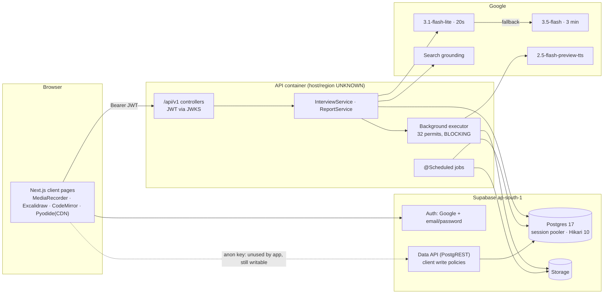
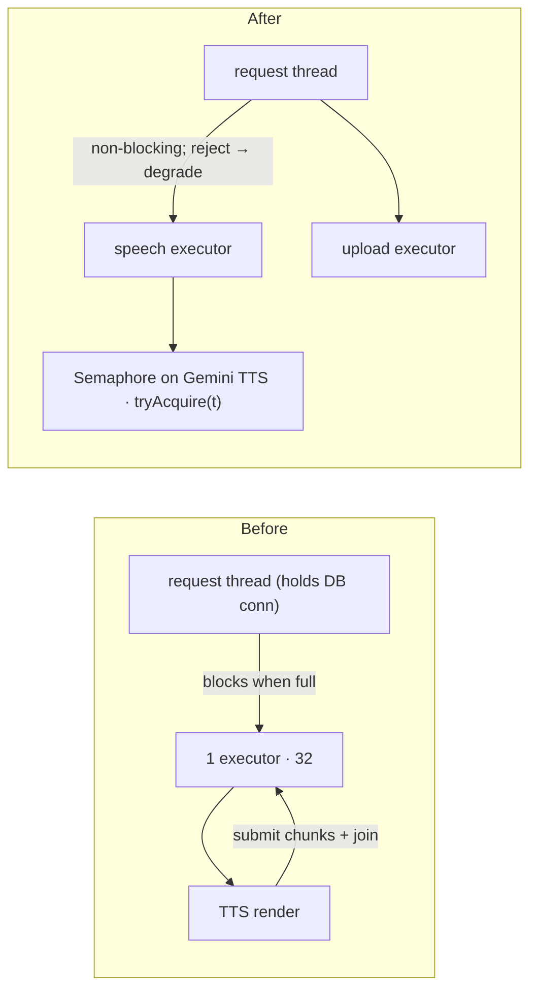
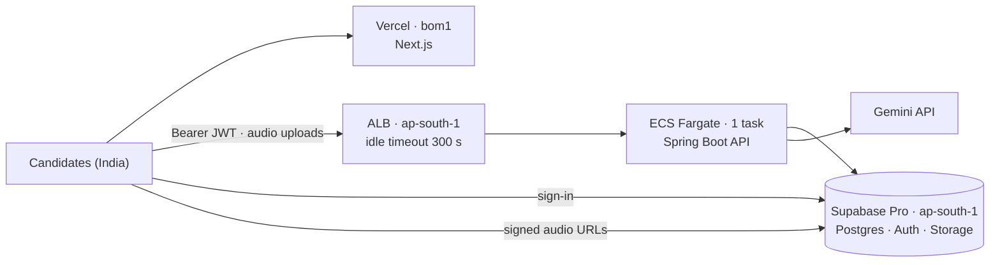

# Architecture audit — Untiered (pre-launch)

| | |
|---|---|
| Date | 14 October 2026 |
| Revision audited | `develop` at `f1c5d42` |
| Method | Static review, plus Spring 7.0.9 / Boot 4.1.1 framework sources read to confirm runtime behaviour. No code changed, no live AI calls, no load tests. |
| Database | Not queried. The Supabase account available to the reviewer does not contain this project (`AIInterviewer`, ap-south-1). Anything that needs the live database is marked **UNKNOWN**, with the SQL to settle it in [Verification queries](#verification-queries-read-only). |
| Status | All findings **open**. Update the Status column in the register as items ship. |
| Decisions since | 14 Oct 2026: owner confirmed nothing is hosted yet and the Supabase project is on the Free tier. Target deployment recorded in [§11](#11-target-deployment-decided-14-october-2026). Owner then chose to delete interview audio after the report and to plan for ~1,000 monthly users; see [§12](#12-lean-plan-for-1000-monthly-active-users-14-october-2026). |
| Reviewed | 14 Oct 2026: a second reviewer (Codex) raised 7 objections. Each was checked against the code; all were accepted in whole or in part. One new defect (ARCH-022), two unsafe or incomplete fixes (ARCH-003/004), and one cost-accounting gap (ARCH-007) followed. Verdicts and evidence are in [§13](#13-review-of-the-second-reviewers-objections-14-october-2026). **[§8](#8-implementation-roadmap) is now the single remediation plan.** |

> **Sensitive.** ARCH-001 describes an exploit path. This file is already on the public `main` and `develop` branches.
> Exploiting it needs the API, which isn't deployed yet, so P0 item 1 must ship before the API is reachable from the internet.

## Resuming after a context reset

1. Read the [Findings register](#2-findings-register) and the [Roadmap](#8-implementation-roadmap). Both carry status. [§13](#13-review-of-the-second-reviewers-objections-14-october-2026) explains why some fixes changed after review.
2. The first open action is to run [verification queries 1 and 7](#verification-queries-read-only). Query 1 decides whether ARCH-001 is Critical (NO-GO until fixed) or a latent High. Query 7 counts resume files that ARCH-022 has already stranded.
3. Decision D1 in [§8](#8-implementation-roadmap) (keep or stop uploading answer audio) is the owner's to make before the consent copy is changed.
4. Each deep dive lists its evidence (file:line), fix, effort and validation. Re-check that line numbers still match before editing, since the code moves.
5. Hosting and Supabase tier decisions, with the settings each finding depends on, are in [§11](#11-target-deployment-decided-14-october-2026).

---

## 0. Architecture inventory and coverage (Phase 1)

| Layer | What's actually there | Status |
|---|---|---|
| Web | Next.js 16.4, React 19, Tailwind 4. The browser calls the API directly with a Supabase bearer token. `proxy.ts` only redirects signed-out users; it isn't a security boundary. | VERIFIED |
| API | Spring Boot 4.1.1 / Kotlin, Java 21, virtual threads on, JdbcClient with hand-written SQL. Stateless JWT checking (JWKS keys, ES256/RS256, issuer and audience checked). | VERIFIED |
| DB | Supabase Postgres 17 through the **session-mode pooler on :5432**, Mumbai region (ap-south-1). 26 tables, row-level security (RLS) on every one. 30 migrations, applied by hand with `db:push`. | VERIFIED |
| DB pool | Hikari defaults: 10 connections, 30 s wait. The API connects as the `postgres` superuser. No statement timeout. | VERIFIED |
| Storage | Supabase Storage through its REST API with the service-role key, which bypasses RLS. Answer audio, question audio stored as **WAV**, resumes, avatar. | VERIFIED |
| AI | Gemini fallback chain: `gemini-3.1-flash-lite` (20 s deadline while the candidate waits) → `gemini-3.5-flash` (3-minute timeout) → optional text-only Kimi. Speech from `gemini-2.5-flash-preview-tts`. Google Search grounding for loop briefs. Embeddings for the admin pool job only. | VERIFIED |
| Background work | One `SimpleAsyncTaskExecutor` (limit 32) shared by answer uploads and speech. Scheduled jobs: retention every 12 h, storage-deletion queue every minute, event purge every 12 h. | VERIFIED |
| Caches | In-memory maps for loop-brief research (12 h) and model knowledge (7 d). No Redis. | VERIFIED |
| Limits | In-memory hourly limits on 4 routes. Daily allowance of 2 rounds / 60 minutes. 16-turn ceiling per round. | VERIFIED |
| Observability | JSON logs with request ids, Sentry (inactive without a DSN), `interview_events` and `ai_calls` ledgers, health endpoint only (no metrics). | VERIFIED; production DSN UNKNOWN |
| CI/CD | Web and API checks plus Docker builds. **No database and no migrations in CI.** Images are built but never pushed. No deploy pipeline. | VERIFIED |
| Hosting | Not deployed yet. Target: web on Vercel, API on AWS ECS Fargate behind a load balancer, both in Mumbai ([§11](#11-target-deployment-decided-14-october-2026)). | DECIDED, not built |
| Supabase tier | Free: no backups, 1 GB file storage, project pauses when idle. Owner willing to move to Pro (ARCH-020). | VERIFIED (owner) |
| CDN/WAF, Gemini quota tier, email (SMTP), Sentry DSN | — | **UNKNOWN** |



**The core journey traced (answer submission):**

1. `POST /turns` with a request id that stays the same for each turn.
2. The API takes a 10-minute lease on the turn so duplicate submissions are safe.
3. About 9 reads plus about 11 event-ledger inserts, each insert in its own transaction.
4. The audio upload starts on the background executor.
5. Gemini assesses the answer from inline base64 audio plus a prompt of about 6.7K tokens.
6. One transaction writes the answer and the next turn; after commit, speech synthesis is handed to the executor.
7. The browser polls `GET /turns/{i}` **every 400 ms** until the audio is ready, then downloads a WAV.
8. The report is generated synchronously on the first `GET /report`.

**Coverage.**

- **Read in depth:** security and auth config, rate limiting, SessionController, all 1,741 lines of InterviewService, ReportService, the AI layer (Gemini client, fallback, deadlines, prices, spend ledger), QuestionSpeech, the storage client, round and account deletion, resume upload and delete, every migration's RLS policies, indexes and foreign keys, Dockerfiles, CI, `application.yml`, and the web proxy, auth callback, report view and audio polling.
- **Skimmed:** SessionRepository SQL, loop-brief caching, admin access, telemetry, arena and course import caps, prompt *structure*, a stale local bundle.
- **Not reviewed:** the pool generation job and generators (admin-only, off by default), the source fetcher's SSRF guard (admin-only), question bank, arena and course logic, `CandidateStage`/`InterviewPlan` rules, most React components. Coverage of these is not claimed.

---

## 1. Executive summary — the three biggest verified risks

1. **Resume file deletion is wrong in both directions (ARCH-001, ARCH-022).** The normal delete removes the database row and leaves the file in storage, silently. A forged path does the opposite: the same service-role code deletes a whole folder of another user's files, if users can edit their `resumes` row through Supabase's Data API. One grants check decides whether that edit is possible today.
2. **The interview loop can stall or permanently deadlock under a burst or a speech-provider slowdown (ARCH-002).** A blocking 32-slot executor is shared by request threads and by tasks that submit more work back into it. Request threads can block while holding one of the 10 database connections.
3. **Interrupted work isn't recoverable (ARCH-003/004), and the code that guarantees recovery is never run against a real database (ARCH-005).** A deploy or crash locks a candidate's question, or their report, for 10 minutes. The report page has no retry path.

The cost risk sits just behind these: our own request errors are re-sent to a model about 5× pricier, nothing in the app can stop runaway spend, and the spend ledger misses billed calls that fail, which is exactly when spend runs away (ARCH-007).

---

## 2. Findings register

Sorted by priority, in the order of the plan in [§8](#8-implementation-roadmap). "Item n" refers to that plan's numbered items.

| ID | Sev | Category | Finding | Evidence | Priority | Status |
|---|---|---|---|---|---|---|
| ARCH-001 | **Critical** (if grants exist) | Security | Service-role storage delete scoped by a column users can edit | VERIFIED code, grants UNKNOWN | **P0** · item 1 | Open |
| ARCH-022 | High | Privacy | Deleting a resume leaves the file in storage, silently, with no retry record | VERIFIED (added after review) | **P0** · item 1 | Open |
| ARCH-011 | Medium | Security | Unused client write policies, including email squatting that locks a person out | VERIFIED code, grants UNKNOWN | **P0** · item 1 | Open |
| ARCH-002 | High | Reliability | Blocking shared executor; nested submits can deadlock; blocks while holding DB connections | VERIFIED | **P0** · item 2 | Open |
| ARCH-003 | High | Reliability | 10-minute lease plus 30 s shutdown drain → deploys lock live turns. Fix revised after review: renewed short leases, not a startup reset | VERIFIED | **P0** · item 3 | Open |
| ARCH-004 | High | Reliability/UX | Report built inside one long GET; frontend doesn't retry "still generating"; a crash holds the report lease 10 minutes | VERIFIED | **P0** · items 3–4 | Open |
| ARCH-007 | High | AI cost | 4xx errors and bad JSON fall back to a ~5× model; speech "fallback" calls the same model again; no spend brake; the ledger misses billed calls that fail | VERIFIED | **P0** · items 5–6; ledger and spend guard P1 | Open |
| ARCH-020 | High | Ops/Reliability | Supabase Free tier: 1 GB storage fills after ~80 rounds (under two days at 100 daily users), no backups, idle projects pause | VERIFIED (owner: Free tier) | **P0** · item 7 | Open |
| ARCH-016 | Medium (launch) | Ops | Email confirmation is on; built-in Supabase email may be capped at 2 per hour | UNKNOWN | **P0** · item 7 | Open |
| ARCH-005 | High | Reliability | No database in any test; ~1,400 lines of SQL never run in CI | VERIFIED | P1 · first | Open |
| ARCH-021 | Medium | Privacy/Cost | Answer recordings are uploaded and kept 28 days but nothing ever reads them; question audio is kept long after it's played | VERIFIED | P1 · after owner decision D1 | Open |
| ARCH-014 | Medium | Reliability/UX | Rounds that *we* failed still use up the daily allowance, while the message says "Nothing was charged" | VERIFIED | P1 | Open |
| ARCH-012 | Medium | Cost/abuse | Free email signup × per-account AI limits, with no CAPTCHA | INFERRED | P1 | Open |
| ARCH-009 | Medium | AI quality | Evidence check discards every Devanagari quote, so Hinglish reports can come out empty | INFERRED | P1 · run query 4 first | Open |
| ARCH-013 | Medium | Performance | 400 ms polling; whole whiteboard saved every 1 s with no size cap | VERIFIED | P1 (whiteboard) / P2 (polling) | Open |
| ARCH-008 | Medium | AI cost/latency | Prompt layout defeats Gemini's prefix caching | VERIFIED layout, savings UNKNOWN | P2 · gated on the D2 probe | Open |
| ARCH-010 | Medium | AI quality | Scoring calls run at temperature 0.7 with no consistency tests | VERIFIED config | P2 | Open |
| ARCH-015 | Medium | Scale | Assumes one instance; superuser DB role; no statement timeout | INFERRED | P2 | Open |
| ARCH-006 | Low (was Medium) | Availability | Public `/usage` runs 2 full-table counts per *direct* request. The landing page caches it for 5 minutes, so normal traffic is not the problem | VERIFIED | P2 | Open |
| ARCH-018 | Low | Security | Defence in depth: admin ids aren't pinned. No escalation path found; the email allow-list already requires a Google sign-in | VERIFIED | P2 (free to set during P0 item 8) | Open |
| ARCH-017 | Low | Performance | `ai_calls.user_id` foreign key has no index | VERIFIED | P2 | Open |
| ARCH-019 | Low | Performance | WAV question audio; CodeMirror loaded for every round type; unbounded lists | VERIFIED/INFERRED | P2 | Open |

---

## 3. Deep-dive findings

### ARCH-001 — Service-role storage deletion scoped by a client-writable column

**Severity:** Critical if the grants exist, otherwise a latent High · **Category:** Security

**Evidence:**

- [initial_schema.sql:232](../../supabase/migrations/20260825000000_initial_schema.sql#L232): `resumes_update_own` lets a signed-in user UPDATE **any column** of their own resume row, including `storage_bucket` and `storage_path`.
- [ResumeRepository.kt:122-133](../../apps/api/src/main/kotlin/com/interviewos/api/resume/ResumeRepository.kt#L122-L133) returns that row on delete.
- [ResumeService.kt:144](../../apps/api/src/main/kotlin/com/interviewos/api/resume/ResumeService.kt#L144) passes both values straight to `deleteByPrefix`.
- [SupabaseObjectStorage.kt:90-129](../../apps/api/src/main/kotlin/com/interviewos/api/storage/SupabaseObjectStorage.kt#L90-L129) then walks that prefix recursively with the service-role key and deletes everything under it.
- The web app never uses the Data API: there are no `.from(` or `.storage` calls in `apps/web/src`.

**Problem:** A destructive operation that bypasses RLS takes its target from data the client controls.

**Impact:** A user can `PATCH /rest/v1/resumes` with their own token to set `storage_bucket='interview-media', storage_path='<victim-uuid>'`, then call `DELETE /api/v1/me/resume/{id}`. All of that person's recordings are deleted. No API was found that exposes other users' ids, which makes targeting harder. Whether an empty path would walk the whole bucket was not checked, and nobody should test that against production.

**Precondition (UNKNOWN):** the `authenticated` role must hold UPDATE on `public.resumes`. `supabase/config.toml` notes that newer Supabase projects don't grant this automatically, so it may not be live today.

**Reproduction/Verification:**

- Run [verification query 1](#verification-queries-read-only).
- Non-destructive check: with your own token, PATCH only your own resume row's `original_filename`. A 200 or 204 means the row is writable.

**Recommended fix (S, 2–3 h):**

1. One migration that drops every client INSERT/UPDATE/DELETE policy the app doesn't use: `users`, `profiles`, `resumes`, `skills`, `arena_*`, `course_progress`, `daily_question_completions`, and storage insert/delete. Then `revoke insert, update, delete on all tables in schema public from anon, authenticated`.
2. In code, as a second line of defence: in `ResumeService.delete`, require `bucket == resumeBucket && path.startsWith("$userId/")`. Apply the same check to any service-role helper that takes a path read from the database.
3. Ship it in the same change as ARCH-022, which rewrites the same delete. Once that delete removes an exact object instead of walking a folder, a forged path can no longer reach a whole folder, but it could still reach any single object whose name is known. The ownership check stays mandatory.

**Alternatives:** Column-level grants still leave unnecessary surface.

**Risk of change:** Low. Nothing in the app uses these policies, and CLAUDE.md says mobile will use the same API.

**Challenge:** If the grants query comes back empty, this isn't exploitable today. Still ship the code check: one future `grant` or dashboard toggle would silently re-enable it.

**Validation:**

- The grants query shows no client write privileges.
- A unit test confirms deletion is refused when the path isn't under the caller's id.

### ARCH-022 — Deleting a resume leaves its file in storage

**Severity:** High · **Category:** Privacy · *Raised by the second reviewer; missed by this audit, which had marked deletion PASS.*

**Evidence:**

- A resume is stored as a file: `{userId}/{uuid}-{name}` ([ResumeService.kt:71](../../apps/api/src/main/kotlin/com/interviewos/api/resume/ResumeService.kt#L71)).
- On delete, the row is removed first ([ResumeRepository.kt:122-133](../../apps/api/src/main/kotlin/com/interviewos/api/resume/ResumeRepository.kt#L122-L133)), then that file path is passed to `deleteByPrefix` ([ResumeService.kt:144](../../apps/api/src/main/kotlin/com/interviewos/api/resume/ResumeService.kt#L144)).
- `deleteByPrefix` lists the path as a folder ([SupabaseObjectStorage.kt:118](../../apps/api/src/main/kotlin/com/interviewos/api/storage/SupabaseObjectStorage.kt#L118), request body at line 142). Supabase's storage server appends `/` to any list prefix unless `exactMatch` is set ([storage `object.ts`, `searchObjects`](https://github.com/supabase/storage/blob/master/src/storage/object.ts): "assuming prefix is always a folder"). The code doesn't set it, so the listing is empty and nothing is removed.
- Nothing fails, so the `log.error` on [line 146](../../apps/api/src/main/kotlin/com/interviewos/api/resume/ResumeService.kt#L146) never fires. If a real storage error did occur, there'd be no retry: unlike round and account deletion, this path doesn't use `storage_deletion_jobs`.
- [SupabaseObjectStorageDeleteTest.kt](../../apps/api/src/test/kotlin/com/interviewos/api/storage/SupabaseObjectStorageDeleteTest.kt) mocks Supabase's list responses, so it couldn't catch this (see ARCH-005).
- The file does go eventually: account deletion purges `{userId}` in the resumes bucket ([AccountDeletion.kt:51-54](../../apps/api/src/main/kotlin/com/interviewos/api/account/AccountDeletion.kt#L51-L54)).

**Impact:** A candidate who deletes their resume still has it stored, and it stays until they delete their whole account. The UI tells them it's gone. CLAUDE.md requires deletion to actually delete.

**Recommended fix (S, 2–3 h, in the same change as ARCH-001):**

1. Make the storage worker delete the exact object at the job's path *and* anything under it as a folder. One `remove([path])` call before the folder walk is enough. A folder path matches no exact object, so round and account jobs are unaffected. No schema change is needed.
2. In `ResumeService.delete`, delete the row and insert a `storage_deletion_jobs` row for the exact path in one transaction, the same pattern as round deletion. The worker then retries failures.
3. Apply ARCH-001's ownership check before enqueueing.
4. Clean up files already stranded: [query 7](#verification-queries-read-only) lists them; enqueue each one.

**Validation:**

- A unit test shows the worker sends `remove` with the exact file path.
- A test against real storage (`supabase start`, ARCH-005) shows the object is gone after a resume delete.
- Query 7 returns no rows.

### ARCH-002 — Shared blocking executor can stall or deadlock the interview loop

**Severity:** High · **Category:** Reliability

**Evidence:**

- [BackgroundWorkConfig.kt:26-31](../../apps/api/src/main/kotlin/com/interviewos/api/config/BackgroundWorkConfig.kt#L26-L31): a single executor limited to 32.
- In Spring 7.0.9, `execute()` **blocks the thread that submits work** when the limit is reached (`rejectTasksWhenLimitReached=false`, and the throttle waits).
- Three kinds of caller submit work to it:
  - Request threads uploading answer audio: [InterviewService.kt:615-647](../../apps/api/src/main/kotlin/com/interviewos/api/interview/InterviewService.kt#L615-L647).
  - Request threads handing off speech after a commit: [QuestionSpeech.kt:75](../../apps/api/src/main/kotlin/com/interviewos/api/interview/QuestionSpeech.kt#L75). Spring runs that after-commit step *before* releasing the database connection (spring-tx `AbstractPlatformTransactionManager` lines 835 then 846), so a blocked thread **is still holding one of the 10 connections**.
  - The executor's own tasks: speech for longer texts is split into chunks, each chunk is submitted to the same pool, and the parent waits on them with no timeout ([QuestionSpeech.kt:231-234](../../apps/api/src/main/kotlin/com/interviewos/api/interview/QuestionSpeech.kt#L231-L234)). This happens for texts of 200+ characters, which means opening questions.

**Impact:**

- (a) **Permanent deadlock.** If all 32 slots are held by speech tasks waiting to submit their own chunks, nothing can finish. A burst of round starts, such as a campus batch, can trigger it. Every later answer submission hangs at the upload step until the API is restarted.
- (b) **Whole-API stall.** A slowdown in Gemini speech holds slots for up to about 200 s each (see ARCH-007). At about 1K daily users at peak, that needs ~60 slots. Request threads then block while holding connections, the pool empties, background tasks wait 30 s for a connection and fail, and the whole API stalls.

**Reproduction/Verification:**

- Unit test: set the limit to 2 and run two 3-chunk speech renders at once; it hangs.
- Load test: 40 concurrent round starts against a Gemini stub with 15 s added latency, then look for threads parked in `ConcurrencyThrottleSupport.onLimitReached`.

**Recommended fix (S–M, 4–6 h):**

- Give uploads and speech separate executors.
- Never let a request thread block on submitting work: set `setRejectTasksWhenLimitReached(true)` and treat a rejection as "speech unavailable" or "upload later".
- Run speech chunks on unbounded virtual threads, and limit *Gemini calls* with `Semaphore.tryAcquire(timeout)` instead.
- Wait on chunks with a timeout.



**Alternatives:** Raising the limit just moves the cliff. A database-backed job queue is overkill for now.

**Risk of change:** Low–Medium. It touches the hot path, but existing tests cover similar patterns.

**Challenge:** Case (b) is unlikely at 100 daily users. This is still P0 because the outcome is a full outage that needs a restart, and the fix is small.

**Validation:** The hang test passes. The latency-injected load test shows bounded p99 submit time and no parked threads.

### ARCH-003 — A deploy or crash locks the candidate's current question for 10 minutes

**Severity:** High · **Category:** Reliability

**Evidence:**

- Answer and hint requests take a 10-minute lease ([InterviewService.kt:1710](../../apps/api/src/main/kotlin/com/interviewos/api/interview/InterviewService.kt#L1710), [SessionRepository.kt:734-800](../../apps/api/src/main/kotlin/com/interviewos/api/interview/SessionRepository.kt#L734-L800)). Any retry gets a 409 "in progress" until the lease expires.
- Boot 4.1.1 defaults to graceful shutdown with a 30 s drain. An assessment can take 20 s + 180 s, and the background executor isn't drained at all.

**Impact:** Any deploy, out-of-memory kill or crash mid-assessment locks that question for up to 10 minutes. The server-side round clock keeps running. Speech and late uploads in flight are lost (the question falls back to text; the recording is gone).

**Reproduction/Verification:** Stub Gemini to sleep 60 s, kill the API mid-answer, restart, and resubmit. You get a 409 for 10 minutes.

**What already holds:** the answer write is fenced. It only lands `where answered_at is null and answer_request_id = :request` ([SessionRepository.kt:912-914](../../apps/api/src/main/kotlin/com/interviewos/api/interview/SessionRepository.kt#L912-L914)), so two workers on the same turn can't both record an answer. A duplicate costs a second assessment and its side effects, not corrupted state.

**Recommended fix (M, 5–6 h; one mechanism for the answer, hint and report leases):**

- **Renew short leases while the work is alive.** Cut the lease to about 60 s. The process holding it keeps a set of its in-flight leases and extends them every ~20 s (`update … set lease_until = now() + 60 s where request_id = any(:held)`).
  - A crash or kill stops the renewals, so a retry succeeds within about 60 s.
  - A live worker never loses its lease, however long the model takes. That includes an old instance still draining during a deploy.
  - This avoids having to measure a worst-case request time, which would have to include database waits and uploads, not just model time.
- Set `spring.lifecycle.timeout-per-shutdown-phase` and the platform's termination grace period, and the executor's task termination timeout, so in-flight work usually finishes rather than waiting out a lease.

**Rejected after review:** an earlier version of this audit suggested clearing leftover leases at startup. That's unsafe with §11's rolling deploys: ECS starts the new task before stopping the old one (default minimum healthy 100%, maximum 200%), so the new instance would clear leases the draining one still holds, and both would assess the same answer. Timing a deploy can't make it safe; renewal can.

**Hosting note (Fargate, §11):** ECS caps a Fargate task's stop timeout at 120 s, so draining alone can't cover a 200 s assessment. Set `timeout-per-shutdown-phase` to about 110 s, `stopTimeout` to 120 s and the load balancer's deregistration delay to about 120 s. Anything still in flight when the task stops is recovered by lease expiry within about 60 s.

**Validation:**

- Kill the API mid-answer and restart it; the same request succeeds within about 70 s.
- Stub a 150 s assessment and confirm the lease never lapses while it runs.
- With two instances running, a retry during a slow assessment gets 409 "in progress", not a second assessment.

### ARCH-004 — Report generation has no recovery path in the UI

**Severity:** High · **Category:** Reliability/UX

**Evidence:**

- [ReportService.kt:153-247](../../apps/api/src/main/kotlin/com/interviewos/api/interview/ReportService.kt#L153-L247) composes the report inside the GET request, with unlimited thinking and up to 3 minutes per provider.
- [report-view.tsx:38-51](../../apps/web/src/components/report-view.tsx#L38-L51) fetches once and shows a `report_generating` 409 as an error, with no retry.
- The report lease is 10 minutes ([ReportService.kt:575](../../apps/api/src/main/kotlin/com/interviewos/api/interview/ReportService.kt#L575)). A failure inside the process releases it ([lines 240-246](../../apps/api/src/main/kotlin/com/interviewos/api/interview/ReportService.kt#L240-L246)), but a crash or kill doesn't, and a new claim waits for expiry ([SessionRepository.kt:1028](../../apps/api/src/main/kotlin/com/interviewos/api/interview/SessionRepository.kt#L1028)).
- The report save is already fenced on the lease id ([SessionRepository.kt:1090-1110](../../apps/api/src/main/kotlin/com/interviewos/api/interview/SessionRepository.kt#L1090-L1110)), so a shorter lease can't produce two saved reports.

**Impact:** The report is the page the product depends on. It fails visibly on a refresh, or whenever generation takes longer than a proxy or load-balancer timeout. If the API dies mid-generation, every request returns `report_generating` for up to 10 minutes.

**Hosting note (§11):** The browser calls the API directly, so Vercel's limits don't apply to this request. The AWS load balancer's idle timeout does: its 60 s default would cut most report generations and every fallback assessment (up to 200 s). Set it to 300 s. That fixes the timeout half; the refresh half still needs the frontend retry.

**Recommended fix (S, 3 h in the frontend, plus the server half of ARCH-003):**

- **Server:** the report lease uses ARCH-003's renewed 60 s lease. A crashed generation is then reclaimable within about a minute, and the next poll starts it again.
- **Frontend:** treat 409 `report_generating` and 502/504 as "still writing". Keep polling with backoff (5 s rising to 30 s) for up to 10 minutes, then show "Try again" instead of an error.
- *Corrected after review:* the earlier fix (poll for 5 minutes, with the 10-minute lease unchanged) gave up before a crashed lease expired. Either half alone leaves a gap.

**Optional (M):** Start generation as soon as the round completes.

**Challenge:** Generating up front pays for reports nobody opens; the code notes reports are fewer than completed rounds. Measure the open rate first. The retry alone fixes the failure.

### ARCH-005 — The SQL behind every guarantee is never run against a real database

**Severity:** High · **Category:** Reliability

**Evidence:**

- No Testcontainers, H2 or Postgres in [build.gradle.kts](../../apps/api/build.gradle.kts).
- All 705 API tests mock the repositories.
- CI has no database and doesn't apply migrations.
- Never executed: the lease and replay SQL, the report lease, the storage-deletion queue, the deletion cascades, and the one-open-round index. CLAUDE.md records a production break caused by exactly this gap.

**Recommended fix (M, 16–24 h):**

- Run Postgres with pgvector in tests (Testcontainers or `supabase start` in CI) and apply `supabase/migrations`.
- Add repository tests for the lease/replay, report-lease and deletion paths.

**Challenge:** Supabase's `auth` and `storage` schemas make a plain Postgres container awkward to set up. `supabase start` is heavier but matches production exactly. Either is far better than nothing.

### ARCH-007 — Fallback chain bills our own errors at about 5×, with no brake

**Severity:** High · **Category:** AI cost

**Evidence:**

- [GeminiInterviewAi.kt:481-483](../../apps/api/src/main/kotlin/com/interviewos/api/ai/GeminiInterviewAi.kt#L481-L483) turns every 4xx other than 429/404 (including 400 invalid-argument) into a "worth retrying elsewhere" failure. Malformed JSON is treated the same way ([417-419](../../apps/api/src/main/kotlin/com/interviewos/api/ai/GeminiInterviewAi.kt#L417-L419)).
- [FallbackInterviewAi.kt:186](../../apps/api/src/main/kotlin/com/interviewos/api/ai/FallbackInterviewAi.kt#L186) then tries the next model. That class's own doc comment says malformed requests "fail fast", but only the Kimi client actually does.
- Both Gemini entries synthesise speech with the **same** model ([GeminiInterviewAi.kt:107](../../apps/api/src/main/kotlin/com/interviewos/api/ai/GeminiInterviewAi.kt#L107)). A speech 429 or timeout is retried immediately on the identical model, the second time with a 3-minute timeout.
- Nothing reads `ai_calls` to stop spending. The only brake is Google's project spend cap, which shuts off every AI path at once.
- **The ledger misses billed calls that fail** (*added after review*). Usage is written only after a provider succeeds ([FallbackInterviewAi.kt:163-168](../../apps/api/src/main/kotlin/com/interviewos/api/ai/FallbackInterviewAi.kt#L163-L168)). A response with malformed JSON throws before its `usageMetadata` is read ([GeminiInterviewAi.kt:417-420](../../apps/api/src/main/kotlin/com/interviewos/api/ai/GeminiInterviewAi.kt#L417-L420)), although Google bills for it. The class's own comment says so ([FallbackInterviewAi.kt:240](../../apps/api/src/main/kotlin/com/interviewos/api/ai/FallbackInterviewAi.kt#L240)). Timeouts can't be measured at all.

**Impact:** A fallback assessment costs about $0.021 against $0.004, plus up to $0.004 more when the first attempt was billed for bad JSON. Each percentage point of assessments that fall through adds about 4–5% to assessment spend, and it's only visible in the logs. Ledger totals, queries 2–3 and any ledger-based brake read **low**, and they read lowest during the failures the brake exists for.

**Recommended fix (S–M, 6–8 h):**

- 4xx responses other than 408 and 429 don't fall back.
- Malformed JSON gets one retry on the same model before moving up.
- Skip providers that would call an identical model for speech and embeddings.
- **Make the ledger complete before relying on it.** Read `usageMetadata` before parsing the text, carry it on the exception, and write a ledger row for the failed attempt (`outcome = failed`). For timeouts, write a row estimated from the input tokens and mark it as an estimate.
- Add a global daily spend guard: today's `micro_usd` total, cached 60 s, which first turns off optional spending (loop-brief research, hints, drafts) and sends an alert. Set its threshold with headroom for what the ledger still can't see.
- **External backstop (P0, configuration only):** a Google Cloud billing budget with alerts at 50/90/100%, and the project spend cap set above the in-app guard. Google's bill is the source of truth; the ledger is the early warning.
- Alert when more than 5% of calls in an hour fell back.
- Limit answer uploads to about 10 MB. The current 25 MB limit exceeds Gemini's 20 MB inline cap after base64 encoding, so oversize answers fail on both models and end the round.

**Challenge:** Moving to a stronger model after bad JSON *is* a quality feature. Keep it, but as the second attempt, not the first.

### ARCH-008 — Prompt layout prevents prefix caching

**Severity:** Medium · **Category:** AI cost/latency

**Evidence:** [assess-answer.md:7-31](../../apps/api/src/main/resources/ai/prompts/assess-answer.md#L7-L31) puts per-turn values (`minutesElapsed`, `currentQuestion`, `history`) ahead of about 10 KB of fixed instructions. The hint, opening-question and report prompts follow the same pattern. Gemini's caching reuses identical *beginnings* of prompts, so the ~3.3K fixed tokens are billed in full every turn.

**Recommended fix:** Order every prompt as:

1. Fixed instructions.
2. Session-stable brief.
3. Append-only history.
4. Per-turn values.
5. Audio.

**Expected benefit:** About $0.0008 per turn, roughly 10–12% of round cost, plus faster first-token time. This is a hypothesis: it only applies if implicit caching works on `gemini-3.1-flash-lite`, which is UNKNOWN.

**Gate (added after review): measure before rewriting anything.**

1. Run query 2. If any call type shows `avg_cached > 0` on this model, implicit caching works, and the rewrite can be costed from real numbers.
2. If every call shows 0, that proves nothing. The client sends everything as one user message with no `systemInstruction` (none in `ai/`), and per-turn values come first, so caching would miss today either way. Settle it with a two-request probe: the same ~4K-token fixed prefix twice, then read `cachedContentTokenCount`. The probe costs under $0.01, but it's live AI spend, so it needs the owner's go-ahead (CLAUDE.md rule 7).
3. Only if the probe shows cache hits, build the evaluation set and reorder.

**Risk of change:** Medium. Reordering a prompt changes model behaviour, so it needs the evaluation set described in §4.

### Compact findings

- **ARCH-006** (Low; was Medium, corrected after review)
  - **Problem:** `/api/v1/usage` is public ([SecurityConfig.kt:41](../../apps/api/src/main/kotlin/com/interviewos/api/config/SecurityConfig.kt#L41)) and runs two full-table counts with no usable index on every request it receives ([SessionRepository.kt:74-87](../../apps/api/src/main/kotlin/com/interviewos/api/interview/SessionRepository.kt#L74-L87)). The app has no rate limiting for unauthenticated traffic, so a script calling it in a loop takes connections from signed-in users.
  - **Correction:** the earlier claim of two counts *per landing-page view* was wrong. The only caller, the server-rendered landing page ([page.tsx:179](../../apps/web/src/app/page.tsx#L179)), fetches with `next: { revalidate: 300 }` ([api.ts:143-155](../../apps/web/src/lib/api.ts#L143-L155)), the same at the audited revision. With no `dynamic` or `fetchCache` override, the API sees about one call per 5 minutes from the web app. What remains is deliberate abuse.
  - **Fix (<1 h):** cache the result in memory for 60 s; an AWS WAF rate rule if §11's ALB is used.
- **ARCH-009** (Medium)
  - **Problem:** `normaliseForMatch` removes everything outside `[a-z0-9' ]` ([ReportService.kt:606-611](../../apps/api/src/main/kotlin/com/interviewos/api/interview/ReportService.kt#L606-L611)). A Devanagari quote becomes an empty string and is discarded, which removes every competency, strength or development area quoting it. Whether transcripts actually come back in Devanagari is UNKNOWN (query 4).
  - **Fix (2 h):** Unicode-aware matching (`\p{L}\p{N}`, NFC), with tests.
- **ARCH-010** (Medium)
  - **Problem:** every JSON call, including scoring, runs at temperature 0.7 ([GeminiInterviewAi.kt:402](../../apps/api/src/main/kotlin/com/interviewos/api/ai/GeminiInterviewAi.kt#L402)), and nothing measures how consistent scores are.
  - **Challenge:** Google's Gemini 3 guidance has recommended staying at the default temperature of 1.0 and warned that lower values can cause looping. Measure before changing anything.
- **ARCH-011** (Medium)
  - **Problem:** `users_update_own` ([initial_schema.sql:214](../../supabase/migrations/20260825000000_initial_schema.sql#L214)) lets a user change `public.users.email`. Account setup ([UserRepository.kt:24-34](../../apps/api/src/main/kotlin/com/interviewos/api/user/UserRepository.kt#L24-L34)) only handles a conflict on `id`. So if someone writes another person's email into their own row before that person signs up, the victim's first API call returns 500 and keeps doing so. The same policies also allow self-awarded arena progress and direct storage uploads with no size or type limits ([interview_loop.sql:158](../../supabase/migrations/20260826120000_interview_loop.sql#L158)).
  - **Fix:** the same migration as ARCH-001.
- **ARCH-012** (Medium, projection)
  - **Problem:** per account, the API allows 40 loop briefs an hour (each new company triggers a Search-grounded call), 6 resume parses an hour that try the most expensive model first, and 30 drafts an hour. Limits are per account and in memory, not per IP. Email signup is now merged, and there's no CAPTCHA. Worst case is roughly $25–50 a day per scripted account; the grounding price needs checking.
  - **Fix:** Turnstile or hCaptcha on signup (Supabase supports both), about 10 an hour for companies not already cached, and a per-user daily spend cap.
- **ARCH-013** (Medium)
  - **Problem:** question audio is polled every 400 ms ([use-question-audio.ts:21](../../apps/web/src/lib/use-question-audio.ts#L21)). The whiteboard is saved every 1 s ([interview-room.tsx:58](../../apps/web/src/components/interview-room.tsx#L58)) as full JSON, with no size cap, no check that the round is still running ([InterviewService.kt:1177-1184](../../apps/api/src/main/kotlin/com/interviewos/api/interview/InterviewService.kt#L1177-L1184)), and no limit on JSON request size.
  - **Fix:** poll with backoff; save the board every ~5 s plus when the window loses focus; cap it at 2–5 MB; reject saves when the round isn't in progress.
- **ARCH-014** (Medium)
  - **Problem:** usage is recorded when a round *starts* ([InterviewService.kt:414](../../apps/api/src/main/kotlin/com/interviewos/api/interview/InterviewService.kt#L414)) and failures aren't excluded. Meanwhile the user is told "Nothing was charged" ([InterviewService.kt:496](../../apps/api/src/main/kotlin/com/interviewos/api/interview/InterviewService.kt#L496)). Two provider failures use up the whole day's allowance.
  - **Fix (1 h):** don't count rounds that we failed.
- **ARCH-015** (Medium)
  - **Problem:** rate limits and caches are in memory and per instance. Hikari's 10 connections per instance run against a session-mode pooler whose size depends on the Supabase tier. The API connects as the superuser with no statement timeout.
  - **Fix:** address all of this before adding a second instance.
- **ARCH-016** (Medium, launch)
  - **Problem:** email confirmation is on, and local config shows `email_sent = 2` ([config.toml:199](../../supabase/config.toml#L199)). If the hosted project uses Supabase's built-in email, confirmations and password resets won't reach real users.
  - **Fix:** check the hosted Auth → SMTP settings and configure a provider if needed.
- **ARCH-017 / 018 / 019** (Low)
  - **ARCH-017:** add an index on `ai_calls(user_id)` ([ai_spend_ledger.sql:55](../../supabase/migrations/20260909120000_ai_spend_ledger.sql#L55)); without it, account deletion scans the whole ledger.
  - **ARCH-018 (defence in depth; reworded after review):** `allows()` ([AdminAccess.kt:43-50](../../apps/api/src/main/kotlin/com/interviewos/api/sources/AdminAccess.kt#L43-L50)) already requires an allow-listed email **and** a `google` entry in the server-set `app_metadata` providers. No escalation path was found. Abusing it would need email confirmation turned off *and* someone registering the admin's address before the admin first signs in with Google. Set `ADMIN_USER_IDS` anyway, since it costs one environment variable.
  - **ARCH-019:**
    - Question audio is stored as 24 kHz WAV (~48 KB/s; a 15 s opening is ~720 KB, slow on mobile networks); encode it to Opus or MP3 instead.
    - Lazy-load CodeMirror ([interview-room.tsx:10](../../apps/web/src/components/interview-room.tsx#L10)).
    - Paginate `listSessions`.
    - CLAUDE.md and `.env.example` still name 3.5-flash as the main model; config leads with 3.1-flash-lite.
- **ARCH-021** (Medium)
  - **Problem:** every answer is uploaded to storage ([InterviewService.kt:615-647](../../apps/api/src/main/kotlin/com/interviewos/api/interview/InterviewService.kt#L615-L647)) and its path saved, but no query reads `answer_audio_path` and the web app has no playback. The report is built from transcripts. Question audio is only read during the round ([use-question-audio.ts](../../apps/web/src/lib/use-question-audio.ts)), yet it's kept until the 28-day sweep.
  - **Impact:** storage and egress spend, background-executor load (ARCH-002), and retained voice recordings that serve no feature.
  - **Needs owner decision D1 first** (*added after review*). The owner's stated direction (§12) is to keep uploading and delete once the report exists. An earlier version of this audit recommended not uploading at all without flagging that this differs.
    - **Option A (recommended): stop uploading answer audio.** Nothing reads it, the report is built from transcripts, and a retried answer re-sends its audio from the browser. This removes the storage, egress, background-executor load and the retention of anybody's voice.
    - **Option B (owner's stated direction): upload, then delete when the report is saved.** Recordings are kept for the length of the round plus the time until the report is opened, and the costs above remain. Choose this if you expect to build answer playback or re-assessment from audio.
  - **Fix (S, 3–4 h after D1):**
    - Option A: remove the upload. Option B: enqueue deletion of the answer files when `saveReport` succeeds, plus the 28-day sweep for rounds whose report is never opened.
    - Either way: when a round ends, queue the existing storage-deletion job for its question audio.
    - Update the consent copy in `new-interview-form.tsx` and the privacy page in the same change; CLAUDE.md requires that copy to match what is kept.

---

## 4. AI cost model and optimisation plan

**Assumptions (change these to refine; the `ai_calls` queries below replace them with measured values):**

| # | Assumption | Value |
|---|---|---|
| A1 | Share of daily users who do at least one round | 40% |
| A2 | Rounds per such user per day | 1.3 (cap 2) |
| A3 | Answered turns per round | 12 (cap 16) |
| A4 | Answer audio | 75 s × 32 tokens/s ≈ 2,400 tokens |
| A5 | Assessment text input | ~6.7K tokens |
| A5 | Assessment output (incl. thinking) | ~780 tokens |
| A6 | Question speech | ~7 s at 25 tokens/s; opening ~15 s |
| A7 | Report | ~11.5K tokens in, ~5K out (thinking is unlimited) |
| A8 | Prices | taken from the repo's `AiPrices.kt` (dated 10 Sep 2026); not re-verified |

| Call per round | Count | Primary model | If served by 3.5-flash |
|---|---|---|---|
| Answer assessment | 12 | $0.0040 | $0.021 |
| Question speech | 13 | ~$0.0019 | same model either way |
| Report | 1 | $0.010 | $0.062 |
| Opening / composition | 1 | ~$0.002 | ~$0.010 |
| **Round total** | | **≈ $0.085** | **≈ $0.34** |

Share of a normal round: assessments about 56%, speech about 29%, report about 12%. That works out to roughly $1.10 per actively interviewing user per month (about 13 rounds).

| | 100 daily users | 1K | 10K |
|---|---|---|---|
| Rounds per day | 52 | 520 | 5,200 |
| AI per month, normal → if everything falls back | ~$135 → ~$530 | ~$1.3K → ~$5.3K | ~$13K → ~$53K |

Loop-brief search grounding isn't in these numbers; it depends on the grounding price and how many distinct companies people ask about.

The fall-back column is a lower bound. It prices only the call that succeeded, while a first attempt that returned bad JSON was billed too (ARCH-007). For the same reason, ledger-based figures (queries 2–3) under-count whenever calls fail.

**Optimisations, ranked by savings after quality risk:**

1. **Stop paying for our own errors and repeat calls to the same model (ARCH-007).**
   - Savings: the current fall-through rate × about 4× on the calls affected.
   - Quality risk: none.
   - Accept when: zero 4xx fall-throughs, and less than 2% of calls fall through overall.
2. **Reorder prompts for caching (ARCH-008).**
   - Savings: about 10–12% per round, if implicit caching applies.
   - Gate it on an evaluation set: 30–50 owner-recorded or consented answers with reference transcripts.
   - Measure: transcript accuracy, the mix of next actions, score mean and spread over 5 runs, schema failures, p50/p95 latency.
   - Accept when: scores move within ±0.2 and there are no new schema failures.
3. **Spend guards, global and per user.** No savings in normal running, but they cap the tail.
4. **Report thinking budget, around 2,048 tokens.**
   - Savings: 3–5%.
   - Risk: high, because the report is the product.
   - Do it last, with a blind A/B on about 20 reports reviewed by the owner.
5. **Speech (29% of cost).** This is a product decision:
   - browser speech already exists (`speaksLocally`) and could be offered as a low-bandwidth option;
   - a cheaper speech model could be adopted if one becomes available;
   - don't change the voice silently.

**Not recommended:**

- Semantic caching of assessments or reports: every answer is unique, so cached results would be wrong.
- The Batch API for anything a candidate is waiting on.
- Reusing synthesised speech across users by question text: there's little reuse, and it complicates deletion.

---

## 5. Scalability assessment and failure scenarios

Peak concurrency assumes 15% of a day's rounds fall in the busiest hour and an average round lasts 30 minutes.

| | 100 daily users | 1K | 10K |
|---|---|---|---|
| Peak concurrent rounds | ~4 | ~40 | ~390 |
| Assessments and speech calls per minute | ~2 each | ~18 each | ~175 each |
| API requests per second (mostly polls) | <2 | ~8 | ~75 |
| Executor slots in use at normal latency | ~1 of 32 | ~3 | **~25–30** |
| **First bottleneck** | none in normal running; outages and deploys | the speech model's quota tier (UNKNOWN); the executor during speech slowdowns | the executor at *normal* latency; Gemini quotas; a second instance hitting pooler and in-memory limits |
| Cheapest mitigation | P0 list | ARCH-002 fix, check/raise the speech quota, browser speech as a fallback | separate executors, a second instance with a database-backed limiter, polling backoff, Opus audio |

**Infrastructure (INFERRED):**

- One API container (1–2 vCPU, 2 GB) and one web container are enough up to roughly 1K daily users.
- At 10K daily users, storage is about 12 MB per round × 28-day retention ≈ 1.7 TB. That's about $35 a month at Supabase's published rate (to verify); WAV is roughly 40% of it.
- Architectural change becomes necessary at roughly 2–3K daily users, or any burst of 30+ rounds starting at once, for ARCH-002. At 5–10K daily users you need a second instance, batched event writes, and long-polling or server-sent events instead of 400 ms polling.

| Scenario | What happens today | Verdict |
|---|---|---|
| 100 users start rounds at once | Up to ~400 speech-chunk tasks hit a blocking 32-slot pool, while request threads hold database connections | **FAIL** (ARCH-002) |
| Gemini goes down mid-round | Falls back to the same vendor and the same key; Kimi can't hear audio. The round is failed honestly, but the allowance is still used | Partial (ARCH-014) |
| A request is retried 3 times | Answers and hints replay the stored response by request id; starting a round is protected by the one-open-round unique index | PASS |
| The user refreshes mid-operation | Answers: fine. Reports: 409 shown as an error | Partial (ARCH-004) |
| The API dies while writing a report | Every request returns `report_generating` for 10 minutes | **FAIL** (ARCH-004) |
| A user deletes their resume | Row deleted; file stays in storage until the account is deleted; nothing logged | **FAIL** (ARCH-022) |
| The database is briefly down | 30 s wait then 500s; ledger writes are dropped; the model call may be paid twice | Acceptable |
| A user tries another person's data | The API scopes every query checked to the caller (404 otherwise). The Data API is a separate question | PASS / **UNKNOWN** |
| AI spending jumps 10× | No in-app brake; the ledger under-counts the failures driving it; Google's cap shuts all AI off | **FAIL** (ARCH-007) |
| A deploy happens during live rounds | 30 s drain, then a 10-minute lock on the interrupted question | **FAIL** (ARCH-003) |

---

## 6. Caching

| Candidate | Key and isolation | TTL | Verdict |
|---|---|---|---|
| `/usage` counts | Global, no user data. The web app already caches it for 300 s; this protects against direct calls | 60 s; staleness doesn't matter | **Do** (P2) |
| Gemini prefix caching | Handled by Google per project; each prefix holds only that user's brief | Managed by Google | **Only if the ARCH-008 probe shows cache hits**, then with the evaluation set (P2) |
| Loop-brief research and knowledge | Already in memory, keyed by company/role/level, with no user data | 12 h / 7 d | Keep; move to the database only with more than one instance |
| Redis | — | — | Not justified; Postgres tables are enough even with several instances |
| Semantic caching, or reusing speech across users | — | — | **Don't**: wrong results, or deletion complexity |
| Static assets | Next serves hashed `_next/static` files | Immutable | Put a CDN in front (none confirmed today) |

---

## 7. Production readiness checklist

| Item | Result |
|---|---|
| API authentication (JWKS, issuer and audience checked) | **PASS** |
| API object-level authorisation (scoped by token subject, 404s) | **PASS** (spot-checked) |
| Data API write surface minimised | **FAIL** / UNKNOWN until grants are checked |
| Service-role operations derive their scope on the server | **FAIL** |
| Secrets kept out of git and its history | **PASS** |
| Idempotent answers, hints and reports | **PASS** |
| Recovery from crash or deploy mid-turn | **FAIL** |
| Timeouts on external calls | PASS (but 3 minutes is long) |
| Spend circuit breaker | **FAIL** |
| Database tests and migrations in CI | **FAIL** |
| Rate limiting for unauthenticated traffic / WAF | **FAIL** / UNKNOWN |
| Retention, round and account deletion, storage-deletion queue | **PASS** |
| Resume deletion removes the file | **FAIL** (ARCH-022; was wrongly included in the PASS above before review) |
| Personal data kept out of logs and Sentry | **PASS** |
| Health probes | **PASS** |
| Metrics and alerting | **FAIL** (health endpoint only) |
| Sentry in production | UNKNOWN |
| Backups / point-in-time recovery and a restore drill | **FAIL** (Free tier has no backups; fixed by Pro, ARCH-020) |
| Deploy pipeline and rollback | **FAIL** (not deployed yet; plan in §11) |
| Email deliverability | UNKNOWN |
| Legal operator details (`NEXT_PUBLIC_LEGAL_*`) | UNKNOWN |
| Dependency updates (Dependabot) | **PASS** |

---

## 8. Implementation roadmap

**This is the single remediation plan**, revised on 14 October 2026 after the second review ([§13](#13-review-of-the-second-reviewers-objections-14-october-2026)). It replaces every earlier version. Within each tier, items are listed in the order to do them.

**Decisions the owner needs to make:**

| ID | Decision | Recommendation | Blocks |
|---|---|---|---|
| D1 | Answer audio: stop uploading it (A), or upload and delete once the report is saved (B, the direction given earlier) | **A**: nothing reads it, and it's the only option that keeps no one's voice ([ARCH-021](#compact-findings)) | P1 audio item and the consent copy |
| D2 | Go-ahead for the ARCH-008 caching probe (live spend, under $0.01) | Yes, after P0 | P2 prompt work |

**P0 — before the API is reachable from the internet (about 5–6 engineer-days, including the first deployment):**

| # | Item | Findings | Effort | Depends on | Status |
|---|---|---|---|---|---|
| 0 | Run verification queries 1 and 7 (read-only) | 001, 022 | 15 min | — | Open |
| 1 | **Resume and storage deletion, one change.** Drop the unused client write policies and revoke client writes. Check ownership of every service-role path read from the database. Make resume delete enqueue an exact-path storage job in the same transaction as the row delete. Make the worker delete the exact object as well as the folder walk. Enqueue the files query 7 found. Verify once against `supabase start` before merging. | 001, 011, 022 | 5 h | Item 0 | Open |
| 2 | Separate, non-blocking executors; chunk waits with a timeout | 002 | 6 h | — | Open |
| 3 | **Renewed 60 s leases for answers, hints and reports** (one mechanism), plus shutdown-drain settings. No startup lease reset. Verify against `supabase start` before merging. | 003, 004 (server) | 6 h | — | Open |
| 4 | Report page: poll `report_generating` and 502/504 with backoff for up to 10 minutes, then show "Try again" | 004 (client) | 3 h | Item 3 | Open |
| 5 | Fallback classification: 4xx other than 408/429 don't fall back; bad JSON gets one retry on the same model; speech and embeddings skip providers with an identical model; 10 MB answer-upload cap | 007 part 1 | 3 h | — | Open |
| 6 | Google Cloud billing budget alerts (50/90/100%) and a project spend cap (configuration only) | 007 | 30 min | — | Open |
| 7 | Supabase Pro; custom SMTP provider; one restore drill from a daily backup | 020, 016 | 2–4 h | Billing | Open |
| 8 | Hosting per §12 (one VM in Mumbai), with item 3's shutdown settings. Set `ADMIN_USER_IDS` in its config while there (ARCH-018). | — | 1 day | Items 1–3 | Open |

**P1 — first weeks of real traffic:**

| Item | Findings | Effort | Status |
|---|---|---|---|
| Database tests: Postgres in CI with migrations applied; lease, report-lease and deletion tests; one storage test against `supabase start`. First, because every later change touches SQL | 005 | 16–24 h | Open |
| Complete the ledger (billed failures, estimated timeouts), then the daily spend guard with headroom and a fall-through alert | 007 part 2 | 6–8 h | Open |
| Sentry DSN plus alerts on 5xx rate, fall-through share and speech-unavailable rate | — | 4 h | Open |
| Answer audio per D1; question audio deleted when the round ends; consent copy and privacy page in the same change | 021 | 3–4 h | Blocked on D1 |
| Don't count rounds we failed | 014 | 1 h | Open |
| CAPTCHA on signup; lower limits for companies not already cached | 012 | 3–4 h | Open |
| Unicode-aware evidence matching (run query 4 first) | 009 | 2 h | Open |
| Whiteboard size cap and round-state check | 013 | 2 h | Open |

**P2 — after launch, guided by real data:**

- ARCH-008: query 2, then the probe (D2), then the evaluation set and reorder, **only if the probe shows cache hits**
- ARCH-006: 60 s cache on `/usage` (the web app already caches it)
- ARCH-010 temperature evaluation
- ARCH-015 readiness for multiple instances
- ARCH-017, and ARCH-019's polling backoff, Opus audio, lazy-loaded CodeMirror and pagination
- Report thinking-budget experiment
- Speech strategy decision
- Splitting up the 1,741-line `InterviewService`, only once it starts slowing changes down

**What changed from the previous plan:**

- ARCH-022 added and merged into P0 item 1, because it rewrites the same delete as ARCH-001.
- ARCH-003: renewed leases replace both the startup lease reset (unsafe with overlapping deploys) and the "≈ 4-minute" derived lease (no measured upper bound).
- ARCH-004: crash recovery added on the server; the poll window grew from 5 to 10 minutes.
- ARCH-007: Google billing alerts moved into P0; the ledger is completed before the spend guard depends on it.
- ARCH-008 moved from P1 to P2, behind a measurement. ARCH-006 and ARCH-018 moved to P2 or into existing items.
- ARCH-021 waits on owner decision D1.
- §12's Supabase Free option is for a private beta only, not public launch.

---

## 9. Launch verdict: **CONDITIONAL GO**

**Go once the P0 list is done.** If verification query 1 shows that `authenticated` can UPDATE `public.resumes`, the verdict is **NO-GO** until P0 item 1 ships, which is a few hours of work. Either way, item 1 ships before the API is reachable from the internet.

The foundations are better than most pre-launch codebases:

- interview logic stays on the server;
- every query is scoped to the caller;
- turns are idempotent;
- failures are reported honestly instead of faked;
- there's a spend ledger (a lower bound, until P1 completes it) and a retention/deletion queue for rounds and accounts.

The defects are concentrated, specific and cheap to fix.

## 10. Top 5 highest-ROI changes

1. Fix resume and storage deletion together (ARCH-001/011/022). About 5 h; closes cross-account deletion and makes resume deletion real.
2. Separate, non-blocking executors. About 6 h; removes the outage-and-restart failure mode.
3. Renewed leases plus report-page polling (ARCH-003/004). About 9 h; deploys and crashes stop locking questions and reports.
4. Fallback classification plus Google billing alerts. About 3.5 h; stops silent 5× bills and gives a spend signal that doesn't depend on our own ledger.
5. Complete the ledger, then add the spend guard. About 6–8 h; avoids the "Google cap = total outage" failure.

---

## 11. Target deployment (decided 14 October 2026)

Nothing is hosted yet. The owner planned Vercel and AWS, and is on the Supabase Free tier but willing to move to Pro. Prices and limits below are as last published; confirm them with each vendor before committing.

> **Revised for current scale:** for about 1,000 monthly active users, [§12](#12-lean-plan-for-1000-monthly-active-users-14-october-2026) replaces the Fargate setup below with a single small VM. Move to this section's setup when you need zero-downtime deploys or a second API instance.

| Piece | Choice | Region | Why |
|---|---|---|---|
| Web | Vercel. Use Pro once the product is commercial; Hobby is for non-commercial use (check current terms). | Functions region `bom1` (Mumbai). Vercel's default is Washington, D.C. | Native Next.js host, CDN for static assets, preview deploys |
| API | AWS ECS on Fargate: 1 task (1 vCPU / 2 GB) behind an Application Load Balancer (ALB) with an ACM certificate on `api.<your-domain>` | `ap-south-1` (Mumbai) | Always-on container, so background speech, late uploads and scheduled jobs keep running. Takes 25 MB uploads and ~200 s requests. Rolling deploys with draining. |
| Database, auth, storage | Supabase Pro, same project | `ap-south-1` | Backups, storage headroom, no pausing (ARCH-020) |
| Secrets | AWS Secrets Manager or SSM Parameter Store, injected into the task | — | Keeps the service-role and Gemini keys out of images |
| Deploys | GitHub Actions on `main`: build image → push to ECR → `supabase db push` → ECS rolling deploy, authenticated with GitHub OIDC (no long-lived AWS keys). A rolling deploy starts the new task before stopping the old one, so it's safe only with ARCH-003's renewed leases. | — | Migrations land before the code that needs them |



**Why not the alternatives:**

- **API on Vercel or Lambda:** these don't run a long-lived JVM server. Their request-body limits (4.5 MB on Vercel functions, 6 MB for synchronous Lambda) are below answer uploads. Work started after the response (speech, late uploads) is frozen, and `@Scheduled` jobs never run.
- **AWS App Runner:** requests are cut at 120 s, which ends fallback assessments (up to 200 s) and long reports.
- **A single EC2 or Lightsail VM with Docker:** cheapest (~$10–15 a month) and fine at 100 daily users. Every deploy is a restart. Once ARCH-003's renewed leases are in, a turn caught by a restart recovers within about a minute. Reasonable if you accept that brief interruption.

**Settings that matter, tied to findings:**

| Setting | Value | Finding |
|---|---|---|
| ALB idle timeout | 300 s (the 60 s default would cut reports and fallback assessments) | ARCH-004 |
| ALB health check | `/actuator/health/readiness` | — |
| `spring.lifecycle.timeout-per-shutdown-phase` | 110 s | ARCH-003 |
| ECS `stopTimeout` | 120 s (Fargate's maximum) | ARCH-003 |
| ALB deregistration delay | 120 s | ARCH-003 |
| Desired task count | 1, no autoscaling, until ARCH-015 (rate limits and caches are in memory) | ARCH-015 |
| Networking | Public subnets with a public IP on the task, and a security group that only accepts the ALB. This avoids a NAT gateway (~$35+ a month). | — |
| `WEB_ALLOWED_ORIGINS` | The production web domain only. Vercel preview URLs will be refused by CORS; use a staging API if previews need live data. | — |
| Supabase Auth URL configuration | Production domain and its `/auth/callback` in the redirect allow list; Google OAuth client updated to match | — |
| Optional | AWS WAF rate-based rule on unauthenticated paths such as `/api/v1/usage` | ARCH-006 |
| Optional | Graviton (arm64) Fargate, about 20% cheaper; the `eclipse-temurin:21-jre` base image is multi-arch | — |

**Latency effect of region choice:** with the API and database both in Mumbai, each of the roughly 25 database round trips in a turn costs about 1–2 ms, so about 50 ms per turn. With the API in a US region each would be about 200 ms, adding roughly 5 s to every turn. Keeping the API next to the database is the single biggest latency decision here.

**Supabase Free vs Pro (ARCH-020):**

| | Free | Pro ($25/month) |
|---|---|---|
| File storage | 1 GB, about 80 rounds at ~12 MB each | 100 GB included. 28-day retention is ~18 GB at 100 daily users and ~175 GB at 1K (a small overage). |
| Backups | None | Daily, kept 7 days |
| Pausing | Pauses after a week without activity | Never |
| Egress | A few GB; question audio alone is ~5 MB per round | 250 GB included |
| Point-in-time recovery | Not available | Paid add-on (~$100/month, needs Small compute or larger) |

Recommendation:

- Move to Pro before launch. Daily backups plus one restore drill are enough at first.
- Add point-in-time recovery once losing up to a day of data is unacceptable, for example once there are paying users.
- Stay on the included Micro compute; move to Small when CPU or memory stays high at peak.
- Email still needs a custom SMTP provider on Pro (ARCH-016).

**Rough monthly cost at launch (100 daily users):**

| Item | Estimate |
|---|---|
| Supabase Pro | $25 |
| AWS: Fargate (always on), ALB, public IPv4 addresses, CloudWatch logs | ~$60–80 |
| Vercel Pro (once commercial) | $20 per member |
| Email provider | $0–20 |
| AI usage (§4) | ~$135 |
| **Total** | **~$240–280** |

**Order of work:**

1. Supabase Pro and SMTP.
2. P0 code fixes, ARCH-001 first.
3. AWS: ECR repository, ECS cluster and service, ALB with ACM certificate, secrets.
4. Vercel project: root directory `apps/web`, region `bom1`, `NEXT_PUBLIC_*` variables. These are baked in at build time, so redeploy after changing them.
5. CD workflow.
6. Restore drill and one full round on production before inviting users.

---

## 12. Lean plan for 1,000 monthly active users (14 October 2026)

Owner's direction:

- delete interview audio once the report exists (for answer audio, this audit recommends not uploading it at all; that is owner decision D1 in [§8](#8-implementation-roadmap));
- plan for about 1,000 monthly active users;
- the owner's estimate is about ₹7 per 30-minute round (first given as ₹15–20, corrected the same day), which matches the model in §4;
- reduce AI cost per round as the next phase of work.

Rupee figures assume ₹88 per US dollar.

**Storage the product actually needs:**

| Data | Where | Needed after the round? | Plan |
|---|---|---|---|
| Answer recordings | Storage | No. Nothing reads them; the report is built from transcripts. | Decision D1: stop uploading (recommended), or delete when the report is saved (ARCH-021) |
| Question audio (24 kHz WAV, ~4.8 MB per round) | Storage | No. Played once, during the round. | Delete when the round ends |
| Resume PDF | Storage | No. The parsed JSON in the database is what's used, and the file is never served back. | Optional: delete after a successful parse |
| Avatar | Storage | Yes | Keep (~100 KB per user) |
| Profile, skills, parsed resume | Database | Yes | Keep |
| Sessions (one row per round) | Database | Yes; history and progress are derived from them | Keep |
| Transcripts and report | Database | The report yes; transcripts only until the report exists | Keep 28 days (current policy) |
| `interview_events` | Database | Operational only | Largest table: ~300 rows per round, including a heartbeat every 30 s. Cut retention to 7 days, or stop storing heartbeats. |
| `ai_calls` | Database | Yes, for cost control | Keep (~30 small rows per round) |

**Supabase Free at 1,000 monthly users after these changes: it doesn't fit** (estimates; check with queries 5–6):

| Free-tier limit | Expected use | Fits? |
|---|---|---|
| 1 GB file storage | ~0.1 GB of avatars, plus ~0.5 GB if resumes are kept | Yes |
| ~5 GB egress per month | Question audio is still downloaded *during* each round: ~4.8 MB × 5,000 rounds ≈ 24 GB | **No**, unless question audio is compressed (~10× smaller) or served from the API server instead |
| 500 MB database | ~200 KB per round × 28-day retention ≈ 0.9 GB; ~0.3–0.4 GB with 7-day event retention | Borderline |
| Backups | None | Only with your own nightly dump (e.g. a scheduled GitHub Action → private, encrypted S3 bucket) |

**Conclusion (corrected after review):** Free fails on egress, is borderline on database size and has no backups. An earlier version of this section still priced it as a "lean" launch option, which contradicted ARCH-020. Making it fit would take Opus question audio, shorter event retention and a home-made backup job: about 2 days of work to save ~₹2,200 a month against an AI bill of ~₹37,500. **Use Free only for a private beta of a few dozen testers. Move to Pro before public launch (P0 item 7).**

**Hosting at this scale:**

- **API:** one 2 GB AWS Lightsail or EC2 (t4g.small) instance in Mumbai, ~$10–12 a month. Run Docker with Caddy for HTTPS, and deploy at night. Restarts are safe once ARCH-003's renewed leases are in: a turn caught by a restart recovers within about a minute.
- **Web:** Vercel Hobby (free) until the product is commercial, then Pro.
- **Upgrade path:** move to §11's Fargate setup when zero-downtime deploys or a second instance are needed.

**Monthly cost at 1,000 monthly active users (assuming 5 rounds each = 5,000 rounds):**

| Item | Monthly |
|---|---|
| API VM | ~₹900–1,100 |
| Web (Vercel Hobby; ~₹1,760 a month on Pro once commercial) | ₹0 |
| Supabase Pro (daily backups included) | ~₹2,200 |
| Email (provider free tier) | ₹0 |
| **Infrastructure** | **~₹3,300** |
| **AI** at ~₹7.5 per round | ₹37,500 |

Infrastructure is about 8% of the bill. AI per round is the number that matters. During a private beta on Supabase Free, infrastructure is about ₹1,000 a month.

**AI cost per round.** §4 models about ₹7.5 per round, and the owner's ~₹7 agrees. Query 3 confirms it from the ledger.

| Part | Cost | Share |
|---|---|---|
| Answer assessments (12) | ₹4.2 | 56% |
| Interviewer voice (13 questions) | ₹2.2 | 29% |
| Report | ₹0.9 | 12% |
| Opening question | ₹0.2 | 3% |

**Cost-reduction levers for the next phase** (estimates from §4; measure each with the `ai_calls` ledger before and after):

| Lever | Saving per round | Quality risk | Notes |
|---|---|---|---|
| Keep it from drifting up: 4xx errors don't fall back, a spend guard, fall-through alerts (ARCH-007) | Prevents ₹7.5 → up to ~₹30 if calls fall back to `gemini-3.5-flash` | None | Do first. It protects the baseline rather than lowering it. |
| Prompt reorder for prefix caching (ARCH-008) | ~₹0.85 (~11%), unmeasured | Medium | Gated on the caching probe (D2), then the evaluation set. Only works if implicit caching applies to `gemini-3.1-flash-lite`. |
| Trim or summarise conversation history after ~6 turns | ~₹0.3–0.5 | Medium | The interviewer may forget earlier answers; test against the evaluation set. |
| Report thinking budget (~2,048 tokens) | ~₹0.3 | High | The report is the product. Blind A/B on ~20 reports. |
| Interviewer voice: shorter spoken questions, browser voice as an opt-in or low-bandwidth mode, or a cheaper speech model if one appears | Up to ₹2.2 | Product decision | Speech cost scales with seconds spoken, not question difficulty. |

Realistic targets: about **₹5.5–6** per round without touching the voice, or about **₹3.5–4** if the voice moves to the browser for some users. Both assume the caching probe succeeds; without it, add about ₹0.85 to each target.

**Usage range at 1,000 monthly users:**

| Rounds per user per month | Rounds | AI at ₹7.5 | AI at ~₹6 (after levers) |
|---|---|---|---|
| 3 | 3,000 | ₹22,500 | ₹18,000 |
| 5 | 5,000 | ₹37,500 | ₹30,000 |
| 10 | 10,000 | ₹75,000 | ₹60,000 |

The daily allowance (2 rounds a day) caps any one user at about 60 rounds a month.

---

## 13. Review of the second reviewer's objections (14 October 2026)

A second reviewer (Codex) challenged this audit. Each objection was checked against the code at `f1c5d42`. The cited code is unchanged on the current `develop`; `page.tsx` changed, but not its usage fetch. All seven were accepted in whole or in part. The changes are already applied throughout this document.

| # | Objection | Verdict | Evidence | Change made |
|---|---|---|---|---|
| 1 | Resume delete leaves the file in storage; no retry record | **Accepted, and worse than stated** | The path is a file ([ResumeService.kt:71](../../apps/api/src/main/kotlin/com/interviewos/api/resume/ResumeService.kt#L71)) but is listed as a folder, and the storage server appends `/` to list prefixes. The failure is silent, so even the error log never fires. | New ARCH-022; checklist PASS split; P0 item 1 |
| 2 | Five-minute report polling can't outlast a crashed 10-minute report lease | **Accepted** | `REPORT_LEASE_SECONDS = 600` ([ReportService.kt:575](../../apps/api/src/main/kotlin/com/interviewos/api/interview/ReportService.kt#L575)); released only on in-process failure (240-246). | ARCH-004 gets the renewed lease plus a 10-minute poll |
| 3a | Clearing leases at startup duplicates work during rolling deploys | **Accepted** | §11's ECS rolling deploy starts the new task first. The damage is bounded: the answer write is fenced (`answered_at is null and answer_request_id = :request`), so a duplicate costs a second assessment, not corrupt state. | Startup reset removed; renewed leases instead |
| 3b | A "≈ 4-minute" lease needs a measured upper bound for the whole request | **Accepted** | The estimate counted model timeouts only, not database waits or uploads. | Renewal removes the need for an upper bound |
| 4 | The ledger can't serve as actual spend | **Accepted** | Usage is written only on success ([FallbackInterviewAi.kt:163-168](../../apps/api/src/main/kotlin/com/interviewos/api/ai/FallbackInterviewAi.kt#L163-L168)), and the class's comment at line 240 admits it. Bad JSON throws before usage is read ([GeminiInterviewAi.kt:417-420](../../apps/api/src/main/kotlin/com/interviewos/api/ai/GeminiInterviewAi.kt#L417-L420)). | Ledger completion before the guard; Google billing alerts in P0; §4 figures marked as lower bounds |
| 5 | `/usage` doesn't run per landing-page view | **Accepted** | `next: { revalidate: 300 }` at the audited revision; the only caller is the server-rendered landing page; no `dynamic` or `fetchCache` override. | ARCH-006 lowered to Low / P2; abuse concern kept |
| 6a | The Free-tier plan contradicts ARCH-020 and fails its own table | **Accepted** | §12's table showed egress "No" and database "Borderline", yet priced Free as a launch option. | Free limited to private beta; the lean cost column removed |
| 6b | "Never upload answer audio" differs from the owner's "delete after the report" | **Accepted** | §12 recorded one, ARCH-021 recommended the other, and neither flagged it. | Owner decision D1; this audit still recommends option A |
| 7a | ARCH-018 is defence in depth, not an escalation | **Accepted** | `allows()` requires an allow-listed email and a `google` provider from server-set `app_metadata` ([AdminAccess.kt:43-50](../../apps/api/src/main/kotlin/com/interviewos/api/sources/AdminAccess.kt#L43-L50)). | Reworded; folded into P0 item 8's config at no cost |
| 7b | ARCH-008's savings are unmeasured; check `cached_tokens` first | **Partly accepted** | The priority was wrong: an unmeasured saving shouldn't have been in P1. But today's `cached_tokens` can't settle the question. Per-turn values come first and there's no `systemInstruction`, so caching misses whether or not the model supports it. | Moved to P2, gated on query 2 and then a two-request probe (D2) |

**Lessons for the next audit:**

- A PASS was given to deletion from reading code and tests without checking the external API's semantics. The storage test mocks Supabase's responses, so it encodes the same assumption. Boundary behaviour needs a real-service check (ARCH-005).
- Every proposed fix was reviewed for correctness, but not against the deployment plan in §11. The startup reset was only unsafe under that plan's rolling deploys.

---

## Verification queries (read-only)

Run in the AIInterviewer project's SQL editor.

```sql
-- 1. Is the Data API write path live? (ARCH-001/011)
select table_name, privilege_type from information_schema.role_table_grants
where grantee in ('anon','authenticated') and table_schema = 'public'
  and privilege_type in ('INSERT','UPDATE','DELETE') order by 1, 2;

-- 2. Fall-through rate, cost and cache hits by call, last 14 days (ARCH-007/008)
select call, provider, count(*) calls,
       count(*) filter (where fell_back_from is not null) fell_through,
       round(sum(micro_usd)/1e6, 2) usd, round(avg(cached_tokens)) avg_cached
from public.ai_calls where occurred_at > now() - interval '14 days'
group by 1, 2 order by usd desc;

-- 3. Measured cost per completed round (replaces the $0.085 assumption)
select percentile_cont(array[0.5, 0.9]) within group (order by usd) from (
  select s.id, sum(c.micro_usd)/1e6 usd from public.sessions s
  join public.ai_calls c on c.session_id = s.id
  where s.status = 'completed' and s.created_at > now() - interval '14 days'
  group by s.id) t;

-- 4. Are Hinglish transcripts in Devanagari? (ARCH-009)
select count(*) from public.session_turns t join public.sessions s on s.id = t.session_id
where s.language = 'hindi_english' and t.answer_transcript ~ '[ऀ-ॿ]';

-- 5. Which tables take the space? (§12, Free-tier 500 MB database limit)
select relname, pg_size_pretty(pg_total_relation_size(relid)) total_size, n_live_tup live_rows
from pg_stat_user_tables order by pg_total_relation_size(relid) desc limit 10;

-- 6. File storage by bucket (§12, Free-tier 1 GB limit)
select bucket_id, count(*) objects, pg_size_pretty(sum((metadata->>'size')::bigint)) total_size
from storage.objects group by 1 order by 1;

-- 7. Resume files left behind by deleted resumes (ARCH-022). Avatars share the bucket and are excluded.
select o.name, o.created_at
from storage.objects o
where o.bucket_id = 'resumes'
  and o.name not like '%/avatar-%'
  and not exists (select 1 from public.resumes r
                  where r.storage_bucket = o.bucket_id and r.storage_path = o.name)
order by o.created_at;
```

## Open questions that would change the conclusions

1. ~~Where is the API hosted, and what's the proxy timeout?~~ Answered 14 Oct 2026: not hosted yet; target in §11.
2. ~~Supabase tier and point-in-time recovery?~~ Answered 14 Oct 2026: Free tier, no recovery; Pro planned (ARCH-020).
3. Results of queries 2–3 would replace the cost assumptions in §4 with measured numbers.
4. Gemini quota tier for the speech model (the likely first external bottleneck at ~1K daily users, §5).
