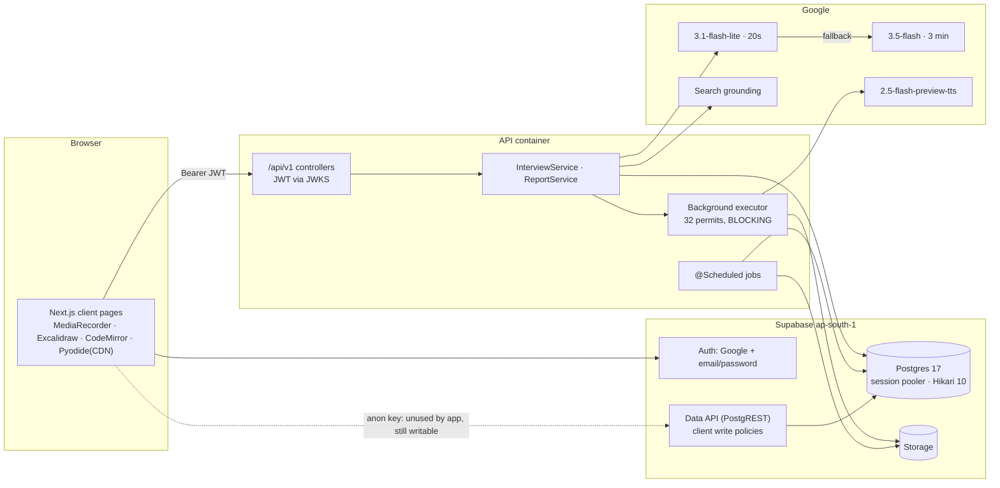
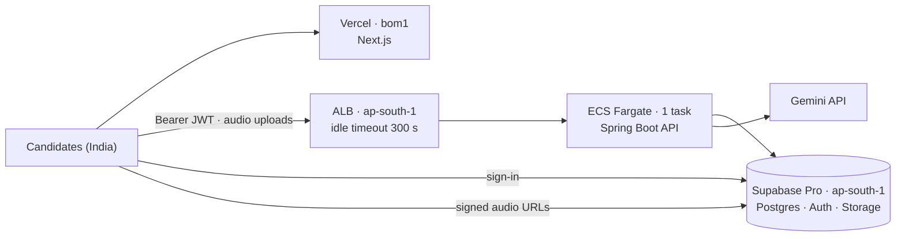

# Architecture audit — Untiered

The engineering reference behind the [launch plan](launch-plan.md). The plan says what to do and in what order, and tracks status. This file holds the evidence and fix details for each finding.

| | |
|---|---|
| Date | 14 October 2026; revised the same day after a second review ([Appendix G](#appendix-g-review-history)) |
| Code audited | `develop` at `f1c5d42` |
| Method | Static review, plus the Spring 7.0.9 / Boot 4.1.1 sources to confirm runtime behaviour. No live AI calls, no load tests. |
| Database | Not queried; the reviewer's Supabase account doesn't hold this project. Facts that need it are marked **UNKNOWN**, and the [verification queries](#7-verification-queries) settle them. |
| Owner input | Nothing is hosted yet. Supabase is on Free, with Pro planned. Plan for about 1,000 monthly users. |

> **Sensitive.** ARCH-001 describes an exploit path, and this file is public. It needs the API, which isn't deployed yet. Ship launch-plan item 1 before it is.

## Contents

1. [Resuming work](#1-resuming-work)
2. [Summary](#2-summary)
3. [Findings register](#3-findings-register)
4. [Before launch (P0)](#4-before-launch-p0)
5. [First weeks (P1)](#5-first-weeks-p1)
6. [Later (P2)](#6-later-p2)
7. [Verification queries](#7-verification-queries)
8. Appendices: [A. Architecture](#appendix-a-architecture-and-coverage) · [B. AI cost](#appendix-b-ai-cost-model) · [C. Scale](#appendix-c-scale-and-failure-scenarios) · [D. Caching](#appendix-d-caching) · [E. Readiness checklist](#appendix-e-production-readiness-checklist) · [F. Hosting](#appendix-f-hosting-and-supabase) · [G. Review history](#appendix-g-review-history)

---

## 1. Resuming work

For an agent or engineer picking this up cold:

1. Status lives in the [launch plan](launch-plan.md), not here.
2. The first open action is [queries 1 and 7](#7-verification-queries). Query 1 shows whether ARCH-001 is live. Query 7 lists resume files that ARCH-022 has already stranded.
3. The owner has to decide about answer recordings before ARCH-021 or the consent copy changes.
4. Line numbers in the evidence move as code changes. Re-check them before editing.

## 2. Summary

**Conditional go.** Launch once the launch plan's "Before launch" items are done. The three biggest risks are deletion (ARCH-001, ARCH-022), a freezing executor (ARCH-002) and crash lockouts (ARCH-003, ARCH-004). Cost runs a close fourth (ARCH-007).

## 3. Findings register

Sorted by priority. "Item" refers to the numbered items in the launch plan's "Before launch" list.

| ID | Finding | Severity | Priority |
|---|---|---|---|
| ARCH-001 | A forged path can delete another user's files | Critical if grants exist | P0 · item 1 |
| ARCH-022 | Resume deletion leaves the file in storage | High | P0 · item 1 |
| ARCH-011 | Unused client write policies | Medium | P0 · item 1 |
| ARCH-002 | Shared blocking executor can freeze the API | High | P0 · item 2 |
| ARCH-003 | A crash or deploy locks the current question | High | P0 · item 3 |
| ARCH-004 | The report page has no recovery path | High | P0 · items 3–4 |
| ARCH-007 | Our own errors are billed at about 5×, with no brake | High | P0 · items 5–6; rest P1 |
| ARCH-020 | Supabase Free can't run the product | High | P0 · item 7 |
| ARCH-016 | Sign-up emails may not reach users | Medium | P0 · item 7 |
| ARCH-005 | Database code is never tested | High | P1, first |
| ARCH-021 | Answer recordings are kept but never used | Medium | P1, after owner decision |
| ARCH-014 | Rounds we fail still use up the daily allowance | Medium | P1 |
| ARCH-012 | Free sign-up multiplies per-account AI limits | Medium | P1 |
| ARCH-009 | Hindi-script quotes are dropped from reports | Medium | P1 |
| ARCH-013 | Heavy polling and whiteboard saves | Medium | P1 / P2 |
| ARCH-008 | Prompt layout prevents prefix caching | Medium | P2, gated on a test |
| ARCH-010 | Scoring temperature is untested | Medium | P2 |
| ARCH-015 | Built for one instance only | Medium | P2 |
| ARCH-006 | Public usage counter can be hammered | Low | P2 |
| ARCH-018 | Admin ids aren't pinned | Low | P2 |
| ARCH-017 | `ai_calls.user_id` has no index | Low | P2 |
| ARCH-019 | Smaller performance items | Low | P2 |

---

## 4. Before launch (P0)

### ARCH-001: A forged path can delete another user's files

Critical if client grants exist, otherwise a latent High · Security · Item 1 · about 3 h, shared with ARCH-022 and ARCH-011

**Problem.** Resume deletion uses the service-role key, which bypasses row-level security. It takes the bucket and path to delete from the `resumes` row. Users can edit that row through Supabase's Data API (policy `resumes_update_own`). So a user could:

1. `PATCH /rest/v1/resumes` with their own token, setting `storage_bucket = 'interview-media'` and `storage_path = '<victim-id>'`;
2. call `DELETE /api/v1/me/resume/{id}`.

Every recording in the victim's folder would be deleted. No API exposes other users' ids, which makes targeting harder. Whether an empty path would walk the whole bucket wasn't checked; don't test that against production.

**Precondition (UNKNOWN).** The `authenticated` role must hold UPDATE on `public.resumes`. Newer Supabase projects don't grant it automatically. Query 1 settles it. A non-destructive check is to PATCH your own row's `original_filename` with your own token; a 200 or 204 means the row is writable.

**Fix.**

1. One migration that drops every client INSERT, UPDATE and DELETE policy the app doesn't use (`users`, `profiles`, `resumes`, `skills`, `arena_*`, `course_progress`, `daily_question_completions`, and storage insert and delete), then `revoke insert, update, delete on all tables in schema public from anon, authenticated`. The web app never uses the Data API, and mobile will use the same API, so the risk is low.
2. In code, refuse the delete unless `bucket == resumeBucket && path.startsWith("$userId/")`. Apply the same check wherever a service-role call takes a path read from the database.
3. Ship together with ARCH-022. Even an exact-object delete could reach any single file whose name is known, so the check stays.

Ship the code check even if query 1 comes back empty: one future grant or dashboard toggle would silently reopen the hole. Column-level grants were considered, but they leave needless surface.

**Done when.** Query 1 shows no client write privileges, and a unit test shows that a delete outside the caller's folder is refused.

**Evidence.** [initial_schema.sql:232](../../supabase/migrations/20260825000000_initial_schema.sql#L232) · [ResumeRepository.kt:122-133](../../apps/api/src/main/kotlin/com/interviewos/api/resume/ResumeRepository.kt#L122-L133) · [ResumeService.kt:144](../../apps/api/src/main/kotlin/com/interviewos/api/resume/ResumeService.kt#L144) · [SupabaseObjectStorage.kt:90-129](../../apps/api/src/main/kotlin/com/interviewos/api/storage/SupabaseObjectStorage.kt#L90-L129) · no `.from(` or `.storage` calls in `apps/web/src`.

### ARCH-022: Resume deletion leaves the file in storage

High · Privacy · Item 1 · about 2 h, shared with ARCH-001

**Problem.** A resume is stored as a file, `{userId}/{uuid}-{name}`. Deleting it removes the database row, then passes the file path to `deleteByPrefix`, which lists it as a folder. Supabase's storage server treats every list prefix as a folder: it appends `/` unless `exactMatch` is set. So the listing is empty and nothing is deleted.

Nothing fails, so nothing is logged. A real storage failure wouldn't be retried either, because this path doesn't use `storage_deletion_jobs`.

**Impact.** The candidate is told their resume is deleted, but the file stays until they delete their whole account. CLAUDE.md requires deletion to actually delete. The storage test mocks Supabase's list responses, so it couldn't catch this (see ARCH-005).

**Fix.**

1. Storage worker: delete the exact object at the job's path (`remove([path])`) before the folder walk. A folder path matches no object, so round and account jobs are unaffected, and no schema change is needed.
2. `ResumeService.delete`: delete the row and insert a `storage_deletion_jobs` row for the exact path in one transaction, the same pattern as round deletion. The worker then retries failures.
3. Apply ARCH-001's ownership check before enqueueing.
4. Enqueue the stranded files that query 7 finds.

**Done when.** A unit test shows the worker sends `remove` with the exact path; a test against `supabase start` shows the file is gone after a delete; query 7 returns no rows.

**Evidence.** [ResumeService.kt:71](../../apps/api/src/main/kotlin/com/interviewos/api/resume/ResumeService.kt#L71), [144-146](../../apps/api/src/main/kotlin/com/interviewos/api/resume/ResumeService.kt#L144-L146) · [ResumeRepository.kt:122-133](../../apps/api/src/main/kotlin/com/interviewos/api/resume/ResumeRepository.kt#L122-L133) · [SupabaseObjectStorage.kt:118-142](../../apps/api/src/main/kotlin/com/interviewos/api/storage/SupabaseObjectStorage.kt#L118-L142) · [storage server `searchObjects`](https://github.com/supabase/storage/blob/master/src/storage/object.ts) ("assuming prefix is always a folder") · [AccountDeletion.kt:51-54](../../apps/api/src/main/kotlin/com/interviewos/api/account/AccountDeletion.kt#L51-L54) · [SupabaseObjectStorageDeleteTest.kt](../../apps/api/src/test/kotlin/com/interviewos/api/storage/SupabaseObjectStorageDeleteTest.kt).

### ARCH-011: Unused client write policies

Medium · Security · Item 1 · covered by ARCH-001's migration

**Problem.** `users_update_own` lets a user change `public.users.email`. Account setup only handles a conflict on `id`. So if someone writes another person's email into their own row before that person signs up, the victim's first API call fails with a 500, and keeps failing. The same policies allow self-awarded arena progress, and direct storage uploads with no size or type limits.

**Fix.** ARCH-001's migration.

**Evidence.** [initial_schema.sql:214](../../supabase/migrations/20260825000000_initial_schema.sql#L214) · [UserRepository.kt:24-34](../../apps/api/src/main/kotlin/com/interviewos/api/user/UserRepository.kt#L24-L34) · [interview_loop.sql:158](../../supabase/migrations/20260826120000_interview_loop.sql#L158).

### ARCH-002: Shared blocking executor can freeze the API

High · Reliability · Item 2 · 6 h

**Problem.** One executor, limited to 32 tasks, serves both answer uploads and speech. In Spring 7.0.9, `execute()` blocks the submitting thread when the limit is reached. Three callers submit to it:

- request threads uploading answer audio;
- request threads handing off speech after a commit. Spring runs this step before releasing the database connection, so a blocked thread holds one of only 10 connections;
- the executor's own speech tasks. Texts of 200+ characters (opening questions) are split into chunks, each chunk is submitted to the same pool, and the parent waits for them with no timeout.

**Impact.**

- **Deadlock.** If all 32 slots hold speech tasks waiting to submit their chunks, nothing can finish. A burst of round starts, such as a campus batch, can trigger it. Every later answer then hangs until the API is restarted.
- **Stall.** A slowdown in Gemini speech holds each slot for up to about 200 s. At about 1,000 daily users, peak load would need about 60 slots. Request threads block while holding connections, the pool empties, and the API stalls.

This is unlikely at 100 daily users. It's still P0 because the outcome is a full outage that needs a restart, and the fix is small.

**Fix.**

- Give uploads and speech separate executors.
- Never block a request thread on submit: set `setRejectTasksWhenLimitReached(true)`, and treat a rejection as "speech unavailable" or "upload later".
- Run speech chunks on virtual threads, and limit Gemini calls with `Semaphore.tryAcquire(timeout)`.
- Wait for chunks with a timeout.

Raising the limit only moves the cliff, and a database job queue is overkill for now. The change touches the hot path, but similar patterns are already tested.

**Done when.** With the limit set to 2, two 3-chunk renders at once complete; today they hang. Forty concurrent round starts against a Gemini stub with 15 s of added latency show bounded submit times, and no threads parked in `ConcurrencyThrottleSupport.onLimitReached`.

**Evidence.** [BackgroundWorkConfig.kt:26-31](../../apps/api/src/main/kotlin/com/interviewos/api/config/BackgroundWorkConfig.kt#L26-L31) · [InterviewService.kt:615-647](../../apps/api/src/main/kotlin/com/interviewos/api/interview/InterviewService.kt#L615-L647) · [QuestionSpeech.kt:75](../../apps/api/src/main/kotlin/com/interviewos/api/interview/QuestionSpeech.kt#L75), [231-234](../../apps/api/src/main/kotlin/com/interviewos/api/interview/QuestionSpeech.kt#L231-L234) · spring-tx `AbstractPlatformTransactionManager` lines 835 then 846.

### ARCH-003: A crash or deploy locks the current question

High · Reliability · Item 3 · 6 h, including ARCH-004's server half

**Problem.** Answer and hint requests take a 10-minute lease, and any retry gets a 409 "in progress" until it expires. Boot's graceful shutdown drains for 30 s, but an assessment can take 20 s + 180 s, and the background executor isn't drained at all.

**Impact.** A deploy, an out-of-memory kill or a crash mid-assessment locks that question for up to 10 minutes, while the round clock keeps running. Speech and uploads in flight are lost: the question falls back to text, and the recording is gone.

**Already safe.** The answer write only lands `where answered_at is null and answer_request_id = :request`, so two workers can't both record an answer. A duplicate costs a second assessment, not corrupted data.

**Fix.** One mechanism serves the answer, hint and report leases:

- **Short leases, renewed while the work is alive.** Cut leases to about 60 s. The process keeps a set of the leases it holds and extends them every ~20 s (`update … set lease_until = now() + 60 s where request_id = any(:held)`).
  - A crash stops the renewals, so a retry succeeds within about a minute.
  - A live worker never loses its lease, however long the model takes. That includes an old instance still draining during a deploy.
  - Nobody has to measure a worst-case request time.
- Set `spring.lifecycle.timeout-per-shutdown-phase`, the platform's termination grace period and the executor's termination timeout, so in-flight work usually finishes.
- **Don't clear leases at startup.** During a rolling deploy the new instance starts before the old one stops, so both would assess the same answer.

**Done when.**

- Kill the API mid-answer and restart it: the same request succeeds within about 70 s.
- A stubbed 150 s assessment never loses its lease.
- With two instances running, a retry during a slow assessment gets a 409, not a second assessment.

**Evidence.** [InterviewService.kt:1710](../../apps/api/src/main/kotlin/com/interviewos/api/interview/InterviewService.kt#L1710) · [SessionRepository.kt:734-800](../../apps/api/src/main/kotlin/com/interviewos/api/interview/SessionRepository.kt#L734-L800), [912-914](../../apps/api/src/main/kotlin/com/interviewos/api/interview/SessionRepository.kt#L912-L914).

### ARCH-004: The report page has no recovery path

High · Reliability/UX · Items 3 (server) and 4 (page) · 3 h for the page

**Problem.** The report is written inside the first `GET /report`, with unlimited thinking and up to 3 minutes per provider. The page fetches once and shows a 409 `report_generating` as an error. The report lease lasts 10 minutes. A failure inside the process releases it, but a crash doesn't.

**Impact.** The page the product depends on fails on a refresh, or when writing the report outlasts a proxy timeout. After a crash, every request returns `report_generating` for up to 10 minutes.

**Already safe.** Saving the report is fenced on the lease id, so a shorter lease can't produce two saved reports.

**Fix.** Both halves are needed:

- **Server:** use ARCH-003's renewed 60 s lease. A crashed generation can be reclaimed within a minute, and the next poll restarts it.
- **Page:** treat a 409 `report_generating` and a 502/504 as "still writing". Poll with backoff, 5 s rising to 30 s, for up to 10 minutes, then offer "Try again".
- **Hosting:** if a load balancer sits in front, set its idle timeout to 300 s. AWS's 60 s default would cut most report generations.

Starting the report as soon as the round ends is an option, but it pays for reports nobody opens, and fewer reports are opened than rounds are completed. Measure the open rate first.

**Done when.** A refresh during generation shows the report without an error. Killing the API mid-generation, the page recovers within about 2 minutes.

**Evidence.** [ReportService.kt:153-247](../../apps/api/src/main/kotlin/com/interviewos/api/interview/ReportService.kt#L153-L247), [575](../../apps/api/src/main/kotlin/com/interviewos/api/interview/ReportService.kt#L575) · [SessionRepository.kt:1028](../../apps/api/src/main/kotlin/com/interviewos/api/interview/SessionRepository.kt#L1028), [1090-1110](../../apps/api/src/main/kotlin/com/interviewos/api/interview/SessionRepository.kt#L1090-L1110) · [report-view.tsx:38-51](../../apps/web/src/components/report-view.tsx#L38-L51).

### ARCH-007: Our own errors are billed at about 5×, with no brake

High · AI cost · Items 5–6, rest in P1 · 3.5 h now, 6–8 h in P1

**Problem.**

- Every Gemini 4xx except 429 and 404, including 400 invalid-argument, is marked "worth retrying elsewhere", and so is malformed JSON. The next model in the chain costs about 5× as much. The class comment says malformed requests "fail fast", but only the Kimi client actually does.
- Both Gemini entries use the same speech model, so a speech 429 or timeout is retried immediately on the identical model, the second time with a 3-minute timeout.
- Nothing reads `ai_calls` to stop spending. The only brake is Google's project cap, which shuts off every AI path at once.
- **The ledger misses billed calls that fail.** Usage is written only after a provider succeeds, and malformed JSON throws before `usageMetadata` is read, although Google bills for it. The class's own comment says so. Timeouts can't be measured at all.

**Impact.** A fallen-back assessment costs about $0.021 against $0.004, plus up to $0.004 more when the first attempt was billed for bad JSON. Each percentage point of fall-through adds 4–5% to assessment spend, and it only shows in the logs. Ledger totals, queries 2–3 and any ledger-based brake read low, and lowest during the very failures a brake exists for.

**Fix now (items 5–6):**

- 4xx responses other than 408 and 429 don't fall back.
- Malformed JSON gets one retry on the same model before moving up. Moving to a stronger model is a quality feature; it just belongs second, not first.
- Skip providers that would call an identical model for speech and embeddings.
- Cap answer uploads at about 10 MB. The current 25 MB exceeds Gemini's 20 MB inline limit once base64-encoded, so oversize answers fail on both models and end the round.
- Set a Google Cloud billing budget with alerts at 50, 90 and 100%, and set the project spend cap above the in-app guard. Google's bill is the source of truth; the ledger is the early warning.

**Fix in P1:**

- Complete the ledger: read `usageMetadata` before parsing the text, carry it on the exception, and write a row for the failed attempt (`outcome = failed`). For timeouts, write a row estimated from the input tokens and mark it as an estimate.
- Add a daily spend guard on today's `micro_usd`, cached for 60 s. It first switches off optional spending (loop briefs, hints, drafts) and alerts. Set its threshold with headroom for what the ledger can't see.
- Alert when more than 5% of calls in an hour fell back.

**Done when.** There are zero 4xx fall-throughs and under 2% fall-through overall (query 2), and a bad-JSON response produces a ledger row.

**Evidence.** [GeminiInterviewAi.kt:107](../../apps/api/src/main/kotlin/com/interviewos/api/ai/GeminiInterviewAi.kt#L107), [417-420](../../apps/api/src/main/kotlin/com/interviewos/api/ai/GeminiInterviewAi.kt#L417-L420), [481-483](../../apps/api/src/main/kotlin/com/interviewos/api/ai/GeminiInterviewAi.kt#L481-L483) · [FallbackInterviewAi.kt:163-168](../../apps/api/src/main/kotlin/com/interviewos/api/ai/FallbackInterviewAi.kt#L163-L168), [186](../../apps/api/src/main/kotlin/com/interviewos/api/ai/FallbackInterviewAi.kt#L186), [240](../../apps/api/src/main/kotlin/com/interviewos/api/ai/FallbackInterviewAi.kt#L240).

### ARCH-020: Supabase Free can't run the product

High · Ops · Item 7 · 2–4 h

**Problem.** Free gives 1 GB of file storage, which is about 80 rounds at ~12 MB each, or under two days at 100 daily users. It also has no backups, about 5 GB of egress a month and a 500 MB database, and idle projects pause.

**Fix.** Move to Pro ($25 a month) before public launch, and do one restore drill from a daily backup. Free is fine for a private beta of a few dozen testers. The numbers are in [Appendix F](#appendix-f-hosting-and-supabase).

**Done when.** The project is on Pro and a restore drill has been done.

### ARCH-016: Sign-up emails may not reach users

Medium · Ops · Item 7 · under 1 h

**Problem.** Email confirmation is on, and the local config allows `email_sent = 2` per hour. If the hosted project uses Supabase's built-in email, confirmations and password resets won't reach real users. The hosted setting is UNKNOWN.

**Fix.** Check Auth → SMTP on the hosted project and configure a provider. Pro still needs one.

**Evidence.** [config.toml:199](../../supabase/config.toml#L199).

---

## 5. First weeks (P1)

### ARCH-005: Database code is never tested

High · Reliability · First in P1 · 16–24 h

**Problem.** There's no Testcontainers, H2 or Postgres in the build. All 705 API tests mock the repositories, and CI has no database and applies no migrations. So these have never run in a test: the lease and replay SQL, the report lease, the storage-deletion queue, the deletion cascades and the one-open-round index. CLAUDE.md records a production break caused by this gap, and ARCH-022 slipped through it.

**Fix.** Run Postgres with pgvector in tests and apply `supabase/migrations`. `supabase start` in CI is heavier than plain Testcontainers but matches production's `auth` and `storage` schemas. Add tests for the leases, the report lease and deletion, plus one storage test against real storage.

Until this lands, verify launch-plan items 1 and 3 by hand against `supabase start` before merging.

**Evidence.** [build.gradle.kts](../../apps/api/build.gradle.kts).

### ARCH-021: Answer recordings are kept but never used

Medium · Privacy/Cost · P1, after the owner decides · 3–4 h

**Problem.** Every answer is uploaded and its path saved, but nothing reads `answer_audio_path`, the web app has no playback, and the report is built from transcripts. Question audio is only played during the round, yet it's kept until the 28-day sweep.

**Impact.** Storage and egress cost, load on the background executor (ARCH-002), and voice recordings kept for no feature.

**Owner decision:**

- **A (recommended): stop uploading answer audio.** A retried answer re-sends its audio from the browser, so nothing depends on the stored copy.
- **B: upload, then delete once the report is saved.** Add the 28-day sweep for reports never opened. Choose B if answer playback or re-assessment from audio is planned.

**Fix.** Implement A or B. Either way, enqueue deletion of a round's question audio when the round ends. Update the consent copy in `new-interview-form.tsx` and the privacy page in the same change; CLAUDE.md requires the copy to match what is kept.

**Evidence.** [InterviewService.kt:615-647](../../apps/api/src/main/kotlin/com/interviewos/api/interview/InterviewService.kt#L615-L647) · [use-question-audio.ts](../../apps/web/src/lib/use-question-audio.ts).

### ARCH-014: Rounds we fail still use up the daily allowance

Medium · Reliability/UX · P1 · 1 h

**Problem.** Usage is recorded when a round starts, and failed rounds aren't excluded, yet the user is told "Nothing was charged". Two provider failures use up the whole day's allowance.

**Fix.** Don't count rounds that failed on our side.

**Evidence.** [InterviewService.kt:414](../../apps/api/src/main/kotlin/com/interviewos/api/interview/InterviewService.kt#L414), [496](../../apps/api/src/main/kotlin/com/interviewos/api/interview/InterviewService.kt#L496).

### ARCH-012: Free sign-up multiplies per-account AI limits

Medium (projection) · Cost/abuse · P1 · 3–4 h

**Problem.** Each account may run, per hour, 40 loop briefs (each new company triggers a Search-grounded call), 6 resume parses (most expensive model first) and 30 drafts. Limits are per account and in memory, not per IP, and email sign-up has no CAPTCHA. The worst case is about $25–50 a day per scripted account; the grounding price still needs checking.

**Fix.** Turnstile or hCaptcha on sign-up (Supabase supports both); about 10 an hour for companies not already cached; a per-user daily spend cap.

### ARCH-009: Hindi-script quotes are dropped from reports

Medium · AI quality · P1 · 2 h

**Problem.** `normaliseForMatch` strips everything outside `[a-z0-9' ]`. A Devanagari quote becomes an empty string and is discarded, along with every competency, strength or development area that quotes it, so Hinglish reports can come out empty. Whether transcripts actually come back in Devanagari is UNKNOWN; query 4 settles it.

**Fix.** Unicode-aware matching (`\p{L}\p{N}`, NFC), with tests.

**Evidence.** [ReportService.kt:606-611](../../apps/api/src/main/kotlin/com/interviewos/api/interview/ReportService.kt#L606-L611).

### ARCH-013: Heavy polling and whiteboard saves

Medium · Performance · P1 for the whiteboard, P2 for polling · 2 h

**Problem.** Question audio is polled every 400 ms. The whiteboard is saved every second as full JSON, with no size cap, no check that the round is still running, and no limit on JSON request size.

**Fix.** P1: save every ~5 s and when the window loses focus; cap the board at 2–5 MB; reject saves when the round isn't in progress. P2: poll with backoff.

**Evidence.** [use-question-audio.ts:21](../../apps/web/src/lib/use-question-audio.ts#L21) · [interview-room.tsx:58](../../apps/web/src/components/interview-room.tsx#L58) · [InterviewService.kt:1177-1184](../../apps/api/src/main/kotlin/com/interviewos/api/interview/InterviewService.kt#L1177-L1184).

---

## 6. Later (P2)

### ARCH-008: Prompt layout prevents prefix caching

Medium · AI cost/latency · P2, gated on a test · 8–16 h if the test passes

**Problem.** Prompts put per-turn values (`minutesElapsed`, `currentQuestion`, `history`) before about 10 KB of fixed instructions, and the client sends everything as one user message with no `systemInstruction`. Gemini's cache reuses identical prompt beginnings, so the ~3.3K fixed tokens are billed in full every turn. The hint, opening and report prompts follow the same pattern.

**Possible saving.** About $0.0008 per turn (10–12% of a round), plus a faster first token. This only holds if implicit caching works on `gemini-3.1-flash-lite`, which is UNKNOWN.

**Test before rewriting anything:**

1. Run query 2. If any call type shows `avg_cached > 0`, caching works on this model.
2. If every call shows 0, that proves nothing, because today's layout misses the cache either way. Send the same ~4K-token prefix twice and read `cachedContentTokenCount`. This costs under $0.01, but it's live AI spend, so it needs the owner's go-ahead (CLAUDE.md rule 7).
3. Only if it hits: build the evaluation set ([Appendix B](#appendix-b-ai-cost-model)) and reorder every prompt as fixed instructions → session brief → append-only history → per-turn values → audio.

**Risk.** Medium, because reordering a prompt changes model behaviour.

**Evidence.** [assess-answer.md:7-31](../../apps/api/src/main/resources/ai/prompts/assess-answer.md#L7-L31).

### ARCH-010: Scoring temperature is untested

Medium · AI quality · P2

Every JSON call, including scoring, runs at temperature 0.7, and nothing measures how consistent scores are. Google's Gemini 3 guidance recommends the default of 1.0 and warns that lower values can cause looping. Measure before changing anything. Evidence: [GeminiInterviewAi.kt:402](../../apps/api/src/main/kotlin/com/interviewos/api/ai/GeminiInterviewAi.kt#L402).

### ARCH-015: Built for one instance only

Medium · Scale · P2

Rate limits and caches are in memory, per instance. Hikari's 10 connections per instance run against a session-mode pooler whose size depends on the Supabase tier. The API connects as the superuser, with no statement timeout. Fix all of this before adding a second instance.

### ARCH-006: Public usage counter can be hammered

Low · Availability · P2 · under 1 h

`/api/v1/usage` is public and runs two full-table counts, with no usable index, on every request. The landing page is fine: it's server-rendered and caches the call for 5 minutes (`next: { revalidate: 300 }`, no override). But a script calling the API directly in a loop would take connections from signed-in users, and there's no rate limiting for unauthenticated traffic. Fix: cache the result in memory for 60 s, plus a WAF rate rule if a load balancer is used. Evidence: [SecurityConfig.kt:41](../../apps/api/src/main/kotlin/com/interviewos/api/config/SecurityConfig.kt#L41) · [SessionRepository.kt:74-87](../../apps/api/src/main/kotlin/com/interviewos/api/interview/SessionRepository.kt#L74-L87) · [api.ts:143-155](../../apps/web/src/lib/api.ts#L143-L155) · [page.tsx:179](../../apps/web/src/app/page.tsx#L179).

### ARCH-018: Admin ids aren't pinned

Low · Security (defence in depth) · P2, free to do during item 8

Admin access already requires an allow-listed email **and** a `google` provider in the server-set `app_metadata`. No escalation path was found: abusing it would need email confirmation turned off, and someone registering the admin's address before the admin's first Google sign-in. Set `ADMIN_USER_IDS` anyway; it's one setting. Evidence: [AdminAccess.kt:43-50](../../apps/api/src/main/kotlin/com/interviewos/api/sources/AdminAccess.kt#L43-L50).

### ARCH-017: `ai_calls.user_id` has no index

Low · Performance · P2

Without it, account deletion scans the whole ledger. Evidence: [ai_spend_ledger.sql:55](../../supabase/migrations/20260909120000_ai_spend_ledger.sql#L55).

### ARCH-019: Smaller performance items

Low · Performance · P2

- Question audio is stored as 24 kHz WAV, about 48 KB/s; a 15 s opening is ~720 KB, slow on mobile networks. Encode it as Opus or MP3.
- Lazy-load CodeMirror ([interview-room.tsx:10](../../apps/web/src/components/interview-room.tsx#L10)).
- Paginate `listSessions`.
- CLAUDE.md and `.env.example` still name 3.5-flash as the main model, but the config leads with 3.1-flash-lite.

---

## 7. Verification queries

Read-only. Run them in the project's SQL editor.

```sql
-- 1. Is the Data API write path live? (ARCH-001, ARCH-011)
select table_name, privilege_type from information_schema.role_table_grants
where grantee in ('anon','authenticated') and table_schema = 'public'
  and privilege_type in ('INSERT','UPDATE','DELETE') order by 1, 2;

-- 2. Fall-through rate, cost and cache hits by call, last 14 days (ARCH-007, ARCH-008)
--    Costs are a lower bound until the ledger records failed calls.
select call, provider, count(*) calls,
       count(*) filter (where fell_back_from is not null) fell_through,
       round(sum(micro_usd)/1e6, 2) usd, round(avg(cached_tokens)) avg_cached
from public.ai_calls where occurred_at > now() - interval '14 days'
group by 1, 2 order by usd desc;

-- 3. Measured cost per completed round (replaces the $0.085 assumption; also a lower bound)
select percentile_cont(array[0.5, 0.9]) within group (order by usd) from (
  select s.id, sum(c.micro_usd)/1e6 usd from public.sessions s
  join public.ai_calls c on c.session_id = s.id
  where s.status = 'completed' and s.created_at > now() - interval '14 days'
  group by s.id) t;

-- 4. Are Hinglish transcripts in Devanagari? (ARCH-009)
select count(*) from public.session_turns t join public.sessions s on s.id = t.session_id
where s.language = 'hindi_english' and t.answer_transcript ~ '[ऀ-ॿ]';

-- 5. Which tables take the space? (Free-tier 500 MB database limit)
select relname, pg_size_pretty(pg_total_relation_size(relid)) total_size, n_live_tup live_rows
from pg_stat_user_tables order by pg_total_relation_size(relid) desc limit 10;

-- 6. File storage by bucket (Free-tier 1 GB limit)
select bucket_id, count(*) objects, pg_size_pretty(sum((metadata->>'size')::bigint)) total_size
from storage.objects group by 1 order by 1;

-- 7. Resume files left behind by deleted resumes (ARCH-022). Avatars share the bucket and are excluded.
select o.name, o.created_at
from storage.objects o
where o.bucket_id = 'resumes'
  and o.name not like '%/avatar-%'
  and not exists (select 1 from public.resumes r
                  where r.storage_bucket = o.bucket_id and r.storage_path = o.name)
order by o.created_at;
```

**Open questions that would change conclusions:**

- Queries 2–3 would replace the cost assumptions in Appendix B with measured numbers.
- The Gemini quota tier for the speech model is likely the first external bottleneck at about 1,000 daily users.

---

## Appendix A. Architecture and coverage

| Layer | What's there |
|---|---|
| Web | Next.js 16.4, React 19, Tailwind 4. The browser calls the API directly with a Supabase token. `proxy.ts` only redirects signed-out users; it isn't a security boundary. |
| API | Spring Boot 4.1.1, Kotlin, Java 21, virtual threads, JdbcClient with hand-written SQL. Stateless JWT checks (JWKS, ES256/RS256, issuer and audience). |
| Database | Supabase Postgres 17 in Mumbai, through the session-mode pooler on :5432. 26 tables, all with row-level security; 30 migrations, applied by hand. |
| Database pool | Hikari defaults: 10 connections, 30 s wait. Connects as the `postgres` superuser, with no statement timeout. |
| Storage | Supabase Storage over REST with the service-role key, which bypasses row-level security. Holds answer audio, question audio (WAV), resumes and avatars. |
| AI | Gemini chain: `gemini-3.1-flash-lite` (20 s while the candidate waits) → `gemini-3.5-flash` (3 min) → optional text-only Kimi. Speech from `gemini-2.5-flash-preview-tts`. Search grounding for loop briefs. |
| Background work | One executor (limit 32) for uploads and speech. Scheduled: retention every 12 h, storage deletion every minute, event purge every 12 h. |
| Caches | In memory: loop-brief research (12 h) and model knowledge (7 d). No Redis. |
| Limits | In-memory hourly limits on 4 routes; 2 rounds or 60 minutes a day; 16 turns per round. |
| Observability | JSON logs with request ids; Sentry (off without a DSN); `interview_events` and `ai_calls` ledgers; health endpoint only. |
| CI/CD | Web and API checks and Docker builds. No database or migrations in CI; images aren't pushed; no deploy pipeline. |
| Unknown | CDN/WAF, Gemini quota tier, hosted SMTP, production Sentry DSN. |



**An answer, step by step:**

1. `POST /turns`, with a request id that stays the same for the turn.
2. The API takes a lease on the turn, so duplicate submissions are safe.
3. About 9 reads and 11 event-ledger inserts, each insert in its own transaction.
4. The audio upload starts on the background executor.
5. Gemini assesses the answer from inline base64 audio plus a ~6.7K-token prompt.
6. One transaction writes the answer and the next turn; after commit, speech is handed to the executor.
7. The browser polls `GET /turns/{i}` every 400 ms until the audio is ready, then downloads a WAV.
8. The report is written during the first `GET /report`.

**Coverage:**

- **Read in depth:** security and auth config, rate limiting, SessionController, all of InterviewService, ReportService, the AI layer, QuestionSpeech, the storage client, round, account and resume deletion, resume upload, every migration's policies, indexes and foreign keys, Dockerfiles, CI, `application.yml`, the web proxy, auth callback, report view and audio polling.
- **Skimmed:** SessionRepository SQL, loop-brief caching, admin access, telemetry, arena and course import caps, prompt structure.
- **Not reviewed:** the pool generation job and generators, the source fetcher's SSRF guard (both admin-only), question bank, arena and course logic, `CandidateStage`/`InterviewPlan` rules, most React components.

## Appendix B. AI cost model

**Assumptions** (queries 2–3 replace them with measured values):

| Assumption | Value |
|---|---|
| Daily users who do at least one round | 40% |
| Rounds per such user per day | 1.3 (cap 2) |
| Answered turns per round | 12 (cap 16) |
| Answer audio | 75 s × 32 tokens/s ≈ 2,400 tokens |
| Assessment | ~6.7K tokens in, ~780 out |
| Question speech | ~7 s at 25 tokens/s; opening ~15 s |
| Report | ~11.5K tokens in, ~5K out |
| Prices | From `AiPrices.kt` (10 Sep 2026); not re-checked |

**Cost per round:**

| Call | Count | Normal | If served by 3.5-flash |
|---|---|---|---|
| Answer assessment | 12 | $0.0040 | $0.021 |
| Question speech | 13 | ~$0.0019 | same model |
| Report | 1 | $0.010 | $0.062 |
| Opening | 1 | ~$0.002 | ~$0.010 |
| **Round** | | **≈ $0.085 (₹7.5)** | **≈ $0.34** |

- Assessments are 56% of a round, speech 29%, the report 12% and the opening 3%.
- The fall-back column is a lower bound: a first attempt that returned bad JSON was billed too.
- Loop-brief search grounding isn't included.

**Monthly AI spend:**

| Daily users | 100 | 1,000 | 10,000 |
|---|---|---|---|
| Rounds per day | 52 | 520 | 5,200 |
| Normal | ~$135 | ~$1.3K | ~$13K |
| If everything falls back | ~$530 | ~$5.3K | ~$53K |

**Ways to cut cost, best first:**

| Lever | Saving per round | Quality risk | Note |
|---|---|---|---|
| Stop paying for our own errors (ARCH-007) | Prevents ₹7.5 → up to ~₹30 | None | Protects the baseline |
| Prompt reorder for caching (ARCH-008) | ~₹0.85, unmeasured | Medium | Only if the caching test passes |
| Trim history after ~6 turns | ~₹0.3–0.5 | Medium | The interviewer may forget earlier answers |
| Report thinking budget (~2,048 tokens) | ~₹0.3 | High | The report is the product: blind A/B on ~20 reports |
| Interviewer voice | Up to ₹2.2 | Product decision | Shorter questions, browser voice as an option, or a cheaper model; never change the voice silently |

Targets: about ₹6.5–7 per round, ₹5.5–6 if caching works, or ₹3.5–4 if some users get the browser voice.

**Evaluation set** (needed before any prompt or thinking change): 30–50 owner-recorded or consented answers with reference transcripts. Measure transcript accuracy, the mix of next actions, score mean and spread over 5 runs, schema failures, and p50/p95 latency. Accept a change if scores move within ±0.2 and there are no new schema failures.

**Not recommended:** semantic caching of assessments or reports (every answer is unique), the Batch API for anything a candidate waits on, and reusing synthesised speech across users (little reuse; complicates deletion).

## Appendix C. Scale and failure scenarios

Peak assumes 15% of a day's rounds in the busiest hour, at 30 minutes per round.

| Daily users | 100 | 1,000 | 10,000 |
|---|---|---|---|
| Peak concurrent rounds | ~4 | ~40 | ~390 |
| Assessments per minute | ~2 | ~18 | ~175 |
| API requests per second | <2 | ~8 | ~75 |
| Executor slots in use | ~1 of 32 | ~3 | ~25–30 |
| First bottleneck | Outages and deploys | Speech quota; executor during slowdowns | Executor at normal latency; Gemini quotas |

- One API container (1–2 vCPU, 2 GB) is enough up to about 1,000 daily users.
- At 2–3K daily users, or any burst of 30+ round starts, ARCH-002 must be fixed. At 5–10K you need a second instance, batched event writes, and server-sent events instead of polling.
- At 10K daily users with 28-day retention, storage is about 1.7 TB (about 40% of it WAV).

| Scenario | Today | Verdict |
|---|---|---|
| 100 users start rounds at once | Speech chunks swamp a blocking 32-slot pool | **Fail** (002) |
| Gemini goes down mid-round | The round fails honestly, but still uses the allowance | Partial (014) |
| A request is retried 3 times | Answers and hints replay; round start is protected by a unique index | Pass |
| The user refreshes mid-operation | Answers fine; the report shows an error | Partial (004) |
| The API dies while writing a report | `report_generating` for 10 minutes | **Fail** (004) |
| A user deletes their resume | The file stays in storage | **Fail** (022) |
| The database is briefly down | 30 s wait, then 500s; a model call may be paid twice | Acceptable |
| A user tries another person's data | The API scopes every query; the Data API is the open question | Pass / Unknown |
| AI spending jumps 10× | No in-app brake; the ledger under-counts | **Fail** (007) |
| A deploy during live rounds | The interrupted question locks for 10 minutes | **Fail** (003) |

## Appendix D. Caching

| Candidate | Verdict |
|---|---|
| `/usage` counts | Do: 60 s in memory (P2). The web app already caches for 300 s. |
| Gemini prefix caching | Only if the ARCH-008 test passes |
| Loop-brief research and model knowledge | Keep in memory; move to the database only with a second instance |
| Redis | Not justified; Postgres is enough even with several instances |
| Semantic caching; sharing speech across users | Don't: wrong results, or harder deletion |
| Static assets | Put a CDN in front (Vercel provides one) |

## Appendix E. Production readiness checklist

| Item | Result |
|---|---|
| API authentication | Pass |
| API scopes every query to the caller | Pass (spot-checked) |
| Data API write surface minimised | **Fail** / Unknown until query 1 |
| Service-role operations derive their scope on the server | **Fail** (001) |
| Secrets out of git | Pass |
| Idempotent answers, hints and reports | Pass |
| Recovery from a crash or deploy mid-turn | **Fail** (003, 004) |
| Timeouts on external calls | Pass (3 minutes is long) |
| Spend circuit breaker | **Fail** (007) |
| Database tests and migrations in CI | **Fail** (005) |
| Rate limiting for unauthenticated traffic | **Fail** / Unknown |
| Round and account deletion, storage-deletion queue | Pass |
| Resume deletion removes the file | **Fail** (022) |
| Personal data out of logs and Sentry | Pass |
| Health probes | Pass |
| Metrics and alerting | **Fail** |
| Sentry in production | Unknown |
| Backups and a restore drill | **Fail** (020) |
| Deploy pipeline and rollback | **Fail** (not deployed) |
| Email deliverability | Unknown (016) |
| Legal operator details (`NEXT_PUBLIC_LEGAL_*`) | Unknown |
| Dependency updates (Dependabot) | Pass |

## Appendix F. Hosting and Supabase

Prices are as last published; confirm with each vendor before committing. Rupees assume ₹88 to the dollar.

### Now: one server (up to about 1,000 monthly users)

- **API:** one 2 GB Lightsail or EC2 (t4g.small) instance in Mumbai, about $10–12 a month. Run Docker with Caddy for HTTPS, and deploy at night. Once ARCH-003's renewed leases are in, a turn caught by a restart recovers within about a minute.
- **Web:** Vercel Hobby until the product is commercial, then Pro. Set the functions region to `bom1` (Mumbai); the default is Washington, D.C.
- **Database, auth and storage:** Supabase Pro, same project, Mumbai.
- **Keep the API next to the database.** A turn makes about 25 database round trips: about 50 ms in total from Mumbai, but about 5 s from a US region.

**Monthly cost at 1,000 monthly users** (5 rounds each):

| Item | Monthly |
|---|---|
| API server | ~₹900–1,100 |
| Vercel Hobby (~₹1,760 on Pro once commercial) | ₹0 |
| Supabase Pro, daily backups included | ~₹2,200 |
| Email (provider free tier) | ₹0 |
| **Infrastructure** | **~₹3,300** |
| AI at ~₹7.5 per round | ~₹37,500 |

### What the product needs to store

| Data | Needed after the round? | Plan |
|---|---|---|
| Answer recordings | No; nothing reads them | Owner decision (ARCH-021) |
| Question audio (~4.8 MB per round as WAV) | No; played once | Delete when the round ends |
| Resume file | No; the parsed JSON is used | Optional: delete after a successful parse |
| Avatar | Yes | Keep (~100 KB per user) |
| Profile, skills, parsed resume, sessions | Yes | Keep |
| Transcripts and report | Report yes; transcripts until the report exists | Keep 28 days |
| `interview_events` | Operations only | ~300 rows per round, including a heartbeat every 30 s. Keep 7 days, or drop heartbeats. |
| `ai_calls` | Yes, for cost control | Keep (~30 rows per round) |

### Supabase Free vs Pro

| | Free | Pro ($25 a month) |
|---|---|---|
| File storage | 1 GB (~80 rounds) | 100 GB included |
| Backups | None | Daily, kept 7 days |
| Pausing | After a week idle | Never |
| Egress | ~5 GB | 250 GB included |
| Database | 500 MB | 8 GB included |
| Point-in-time recovery | No | Add-on, ~$100 a month |

**At 1,000 monthly users, Free doesn't fit:**

- Egress: question audio alone is ~4.8 MB × 5,000 rounds ≈ 24 GB, against ~5 GB.
- Database: ~0.9 GB with 28-day event retention, or ~0.3–0.4 GB with 7 days, against 500 MB.
- Backups: none, unless you build your own nightly dump.

Making Free fit would take Opus audio, shorter event retention and a home-made backup job: about 2 days of work to save ~₹2,200 a month. **Use Free for a private beta only. Move to Pro before public launch.** Add point-in-time recovery once losing a day of data becomes unacceptable, for example once there are paying users. Stay on Micro compute until CPU or memory stays high at peak.

### Later: AWS Fargate (zero-downtime deploys, or a second instance)

| Piece | Choice |
|---|---|
| API | ECS on Fargate, 1 task (1 vCPU, 2 GB), behind an Application Load Balancer with an ACM certificate, in `ap-south-1` |
| Secrets | Secrets Manager or SSM Parameter Store, injected into the task |
| Deploys | GitHub Actions: build → push to ECR → `supabase db push` → ECS rolling deploy, with GitHub OIDC (no long-lived AWS keys) |

A rolling deploy starts the new task before stopping the old one, so it's safe only once ARCH-003's renewed leases are in.



| Setting | Value | Why |
|---|---|---|
| Load balancer idle timeout | 300 s | The 60 s default cuts reports (004) |
| Health check | `/actuator/health/readiness` | |
| `spring.lifecycle.timeout-per-shutdown-phase` | 110 s | Drain in-flight work (003) |
| ECS `stopTimeout` | 120 s (Fargate's maximum) | Drain in-flight work (003) |
| Deregistration delay | 120 s | Drain in-flight work (003) |
| Task count | 1, no autoscaling | In-memory limits and caches (015) |
| Networking | Public subnets, security group open only to the load balancer | Avoids a NAT gateway (~$35+ a month) |
| `WEB_ALLOWED_ORIGINS` | Production domain only | Vercel previews need a staging API |
| Supabase Auth redirect list | Production domain and `/auth/callback` | Update the Google OAuth client to match |
| Optional | WAF rate rule on unauthenticated paths | ARCH-006 |
| Optional | Graviton (arm64), about 20% cheaper | The base image is multi-arch |

At launch with 100 daily users, this setup costs about $240–280 a month in total, including about $60–80 for AWS and ~$135 of AI.

**Ruled out:** Vercel functions or Lambda for the API (no long-lived JVM, request bodies capped at 4.5–6 MB, background work frozen, scheduled jobs never run) and AWS App Runner (cuts requests at 120 s).

**Order of work:** Supabase Pro and SMTP → P0 code fixes, ARCH-001 first → server or AWS setup → Vercel project (root `apps/web`, region `bom1`, `NEXT_PUBLIC_*` variables, which are baked in at build time) → deploy workflow → restore drill and one full round on production before inviting users.

## Appendix G. Review history

On 14 October 2026 a second reviewer (Codex) raised seven objections. Each was checked against the code at `f1c5d42`. The cited code is unchanged on `develop`; `page.tsx` changed, but not its usage fetch. All seven were accepted in whole or in part, and this document already reflects them.

| # | Objection | Verdict | What changed |
|---|---|---|---|
| 1 | Resume delete leaves the file in storage | Accepted, and worse than stated: it fails silently | New ARCH-022; the deletion PASS was split |
| 2 | 5-minute report polling can't outlast a crashed 10-minute lease | Accepted | ARCH-004 gets renewed leases and a 10-minute poll |
| 3a | Clearing leases at startup duplicates work during rolling deploys | Accepted; the damage is bounded by the fenced answer write | Startup reset dropped for renewed leases |
| 3b | A "≈ 4-minute" lease needs a measured worst case | Accepted | Renewal removes the need for one |
| 4 | The ledger can't serve as actual spend | Accepted | Ledger completion before the guard; Google alerts moved into P0 |
| 5 | `/usage` doesn't run on every landing-page view | Accepted | ARCH-006 lowered to Low, P2 |
| 6a | The Free-tier plan contradicted its own numbers | Accepted | Free is for private beta only |
| 6b | "Never upload audio" differed from the owner's "delete after the report" | Accepted | Now an owner decision |
| 7a | ARCH-018 is defence in depth, not an escalation | Accepted | Reworded; Low, P2 |
| 7b | Check `cached_tokens` before the prompt rewrite | Partly: the priority was wrong, but today's `cached_tokens` can't settle it | Moved to P2, gated on a two-request test |

**Lessons for the next audit:**

- Deletion was passed from reading code and tests, without checking the storage API's real behaviour. The test mocks Supabase, so it shared the same wrong assumption. Boundary behaviour needs a check against the real service.
- The fixes were checked for correctness, but not against the deployment plan. The startup lease reset was only unsafe under that plan's rolling deploys.
